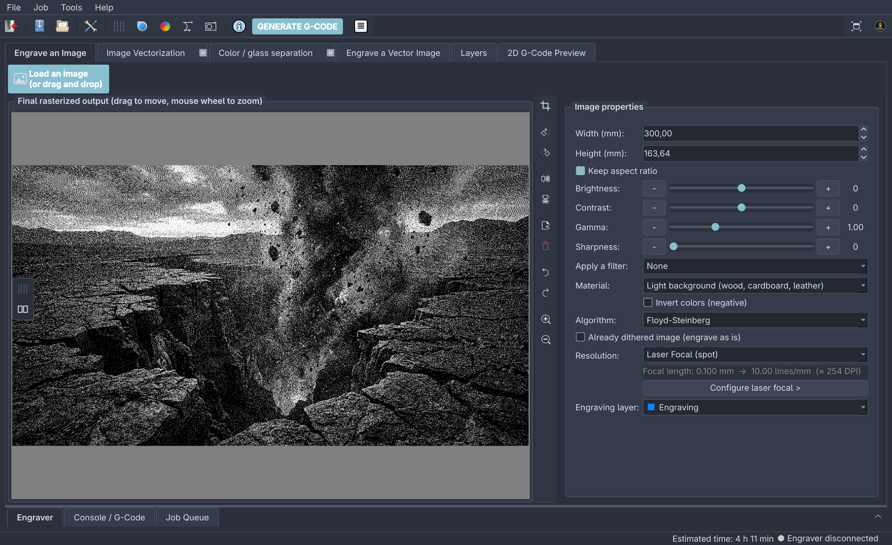
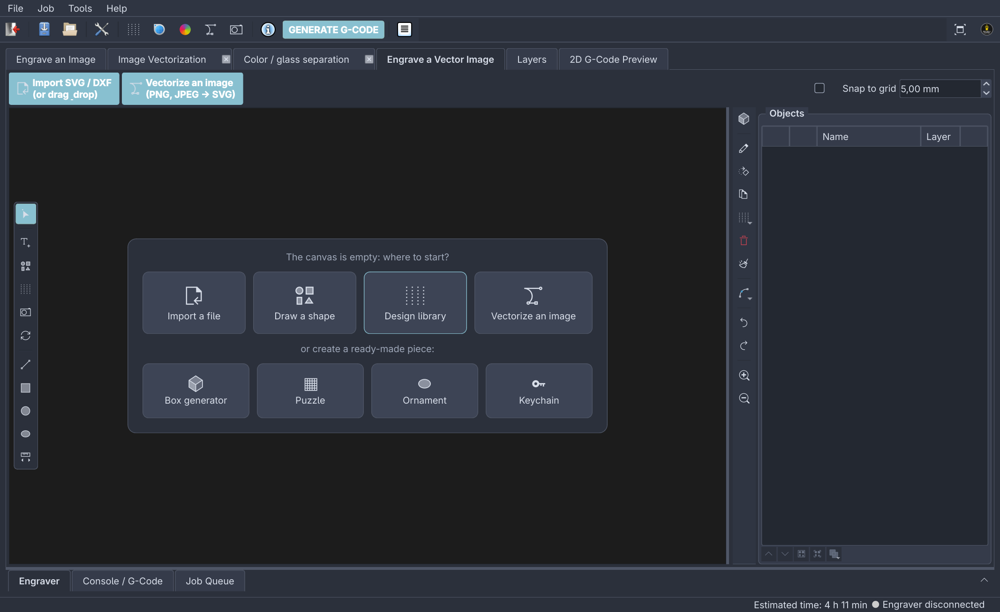
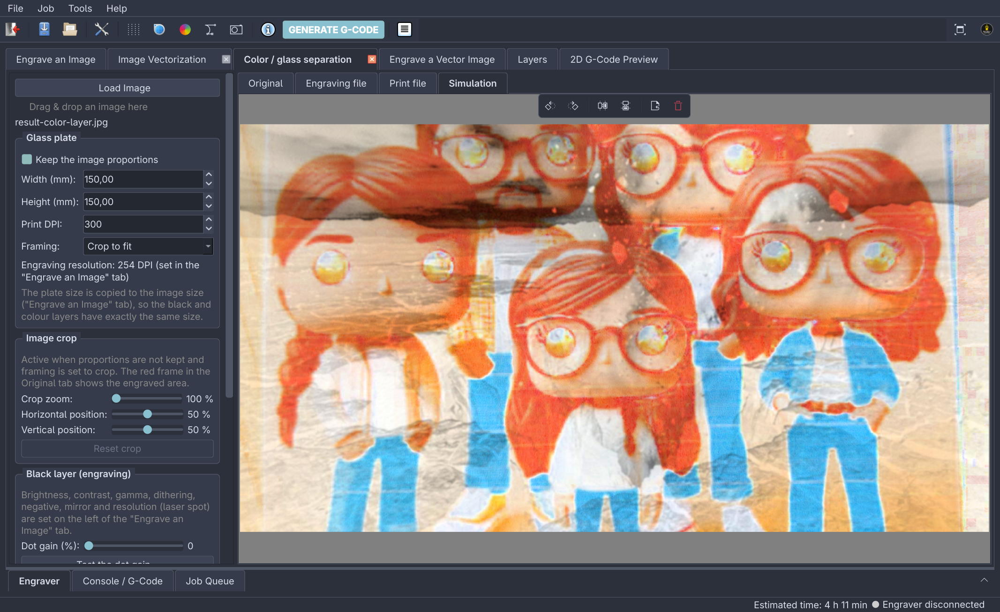
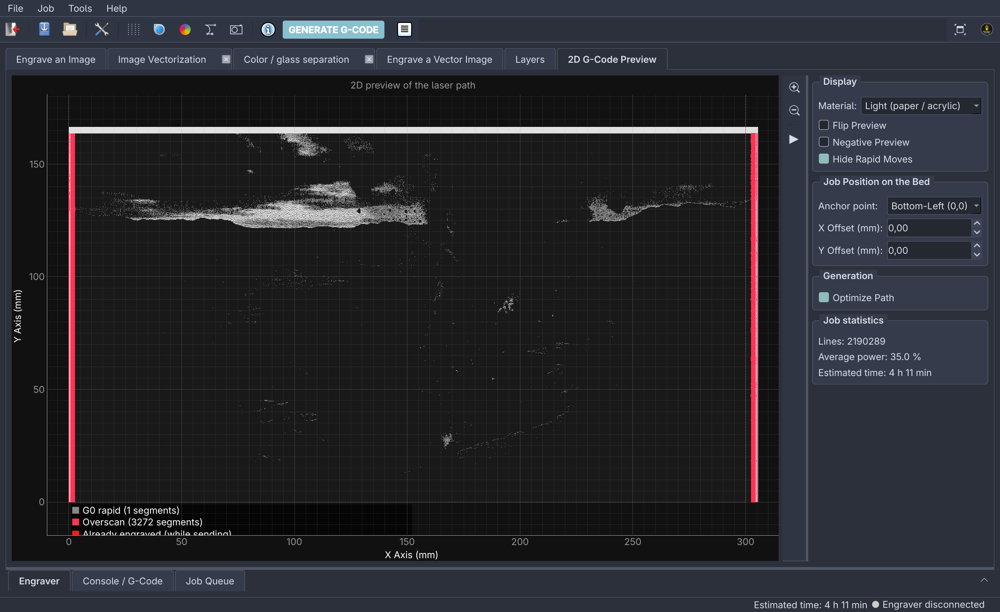
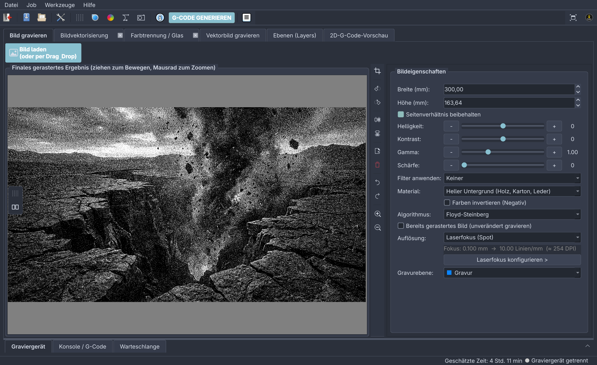

# Laser Studio Pro

[](https://ko-fi.com/jb3dlaser)

*[Version française](README.md)*

## Overview

Laser Studio Pro is GRBL control software for laser engravers and cutters, with:
- image engraving (dithering, grayscale, resolution tied to the spot size),
- material selector (dark or light background) to engrave in negative or positive,
- color / glass separation (black layer to engrave, color layer to print, backlight simulation, 1:1 scale PDF),
- vector cutting and engraving, SVG and DXF import, PNG/JPEG → SVG conversion,
- finger-joint box generator (X/Y/Z dimensions, text or SVG decoration),
- layer management, with their settings remembered per machine,
- guided calibration: test matrix, bidirectional scan offset and dot gain for glass,
- G-Code generation and 2D preview, job queue,
- machine profiles (dimensions, focal spot, GRBL settings, materials),
- project export/import, autosave,
- multilingual interface (Français, English, Deutsch, Español).

The detailed version history is in [`CHANGELOG.md`](CHANGELOG.md) (in French).

## Why is Laser Studio Pro free, and will it stay free?

Laser Studio Pro was built by laser engraving enthusiasts for laser engraving enthusiasts, and because the reference software, LaserGRBL, has not evolved since early 2025.

Its developers chose the [GNU GPL version 3](https://www.gnu.org/licenses/gpl-3.0.html) free software license (see [License](#license)) so that this software stays free and open source. Everyone is free to use it, at no cost, for all their projects, to copy its code, to modify it, to improve it and to share the result with the community. The GPL also guarantees that it will stay that way: any modified version that is redistributed must be published under the same license, with its source code.

## License

Laser Studio Pro is free software: you can redistribute it and/or modify it under the terms of the [GNU General Public License](https://www.gnu.org/licenses/gpl-3.0.html) as published by the Free Software Foundation, either version 3 of the License, or (at your option) any later version (GPL-3.0-or-later).

It is distributed in the hope that it will be useful, but WITHOUT ANY WARRANTY; without even the implied warranty of MERCHANTABILITY or FITNESS FOR A PARTICULAR PURPOSE. The full text of the license is in the [`LICENSE`](LICENSE) file.

## Installation

### Windows

Download the installer from the [releases](https://github.com/Jgood3d/laser-studio-pro/releases) page and run it.

Warning: Windows security may block the installation or the first start of the software as long as the installer is not signed.

### Fedora (Copr)

On Fedora 43, 44 and 45 (x86_64 and aarch64), Laser Studio Pro installs from the [Copr](https://copr.fedorainfracloud.org/coprs/alemorvan/laser-studio-pro/) repository, using Fedora's libraries:

```bash
sudo dnf copr enable alemorvan/laser-studio-pro
sudo dnf install laser-studio-pro
```

The application appears in the applications menu (Stencil Studio with a right click on its icon) and can also be started with `laser-studio-pro`. Updates arrive with the system updates. Stencil Studio's AI subject detection is optional: `sudo dnf install --setopt=install_weak_deps=False python3-onnxruntime`. Access to the serial port requires membership of the `dialout` group (see below).

### Debian and Ubuntu (.deb)

On Debian 13 (trixie) or Ubuntu 25.04 and later, download `laser-studio-pro_<version>_all.deb` from the [releases](https://github.com/Jgood3d/laser-studio-pro/releases) page, then:

```bash
sudo apt install ./laser-studio-pro_<version>_all.deb
```

The package uses the system's Python libraries (PyQt6, OpenCV, NumPy…) and installs the menu entry. Ubuntu 24.04, too old for PyQt6 6.7, uses the AppImage. Building and choosing a package: `packaging/debian/README.md`.

### With pip (Windows, Linux, macOS)

Python 3.10 to 3.14 works: the Python shipped with the distribution is enough (Ubuntu 22.04 and later, Debian 12 and 13, recent Fedora). Install the dependencies for your system:

```bash
pip install -r requirements-windows.txt    # Windows
pip install -r requirements-linux.txt      # Linux
```

`numba` is optional: it speeds up dithering; the application works without it (but dithering is about a hundred times slower).
On Linux, the user must belong to the `dialout` group to access the serial port. Add the user to the group:

```bash
sudo usermod -aG dialout $USER
```

Log out and back in for the group membership to take effect (then check with `groups`).

### Installing in a virtual environment (recommended)

A virtual environment keeps the project's dependencies separate from the system's. From the project folder, create it, activate it, then install the dependencies:

```bash
python3 -m venv .venv
source .venv/bin/activate
pip install -r requirements-linux.txt
```

On Debian and Ubuntu, the `venv` module is a separate package: `sudo apt install python3-venv`.

> **Note**: the dependencies (numpy 2) accept Python 3.10 to 3.14; pip picks the numpy version that matches the installed Python. An environment mixing two Python versions causes the error `ModuleNotFoundError: No module named 'PyQt6'` even though PyQt6 is installed: if in doubt, delete `.venv` and create it again.

The environment must be activated (`source .venv/bin/activate`) in each new terminal before starting the application. To leave it, use `deactivate`.

## Starting the application (dev/pip)

Run `main.py` from the project folder.

```bash
source .venv/bin/activate
python main.py
```

At startup, a safety warning asks for confirmation. Its "Don't show at every startup" box limits it to a reminder every 30 startups. For testing and development, the `NOWARNING` environment variable turns it off completely:

```bash
NOWARNING=1 python main.py
```

The interface language is chosen in File › Settings… › Language and theme.

## Screenshots

Engrave an image (dithering, photo settings, material):



Vector editor: draw, import an SVG or DXF file, or start from a generator:



Color / glass separation (black layer to engrave, color layer to print, simulation):



2D G-Code preview, with the job position on the bed and its statistics:



Interface in German (also in French and Spanish):



Every tab, settings page and main window is shown at the end of the [French README](README.md#captures-de-chaque-onglet-et-page) (French interface).

## What's new in version 3.0.0

A new major version: almost everything has changed.

- **Redesigned interface**: tabs and bottom panel inspired by VS Code, streamlined vector editor, Job menu with keyboard shortcuts, a single confirmation window before engraving.
- **Redesigned style**: new "New Dusk" theme, consistent labels in all four languages.
- **Redesigned code**: MVC pattern (model / view / controller), business logic separated from the user interface, more than 1,500 tests.
- **New generators and tools**: keychain, Christmas ornament, box, puzzle, design library, macros, engraving history, camera alignment, rotary axis (tumblers, bottles, pens).
- **Safer engraving**: emergency stop always visible, framing that follows the outline of the job, resuming an interrupted job.

The details are in the [CHANGELOG](CHANGELOG.md) (in French).

## For developers

- [CONTRIBUTING.md](CONTRIBUTING.md): project structure, building, tests, simulated engraver and debug log;
- [ARCHITECTURE.md](ARCHITECTURE.md): role of each folder and file, glossary of the code objects;
- [BUILD.md](BUILD.md): building for Windows, Linux and macOS;
- [CHANGELOG.md](CHANGELOG.md): detailed version history.

These documents are written in French.

## Acknowledgements

Thanks to everyone who contributes to the project, tests the features and reports bugs.
