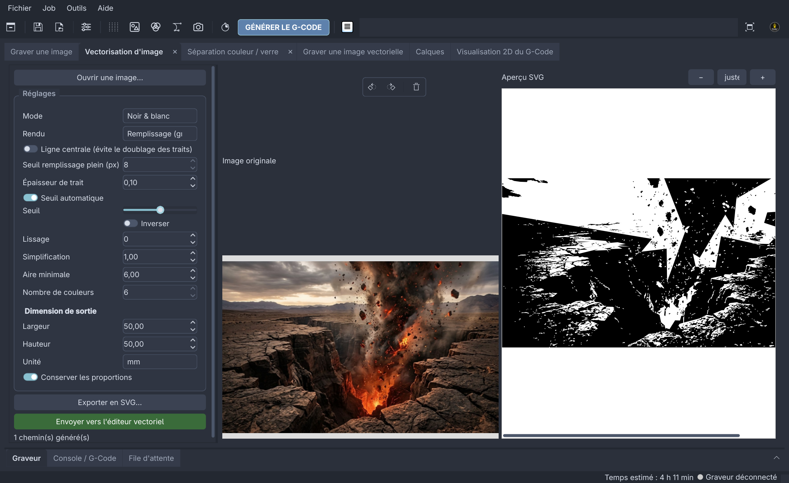
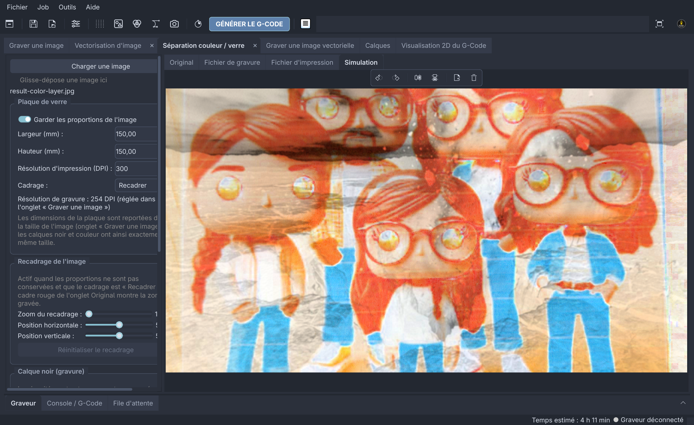
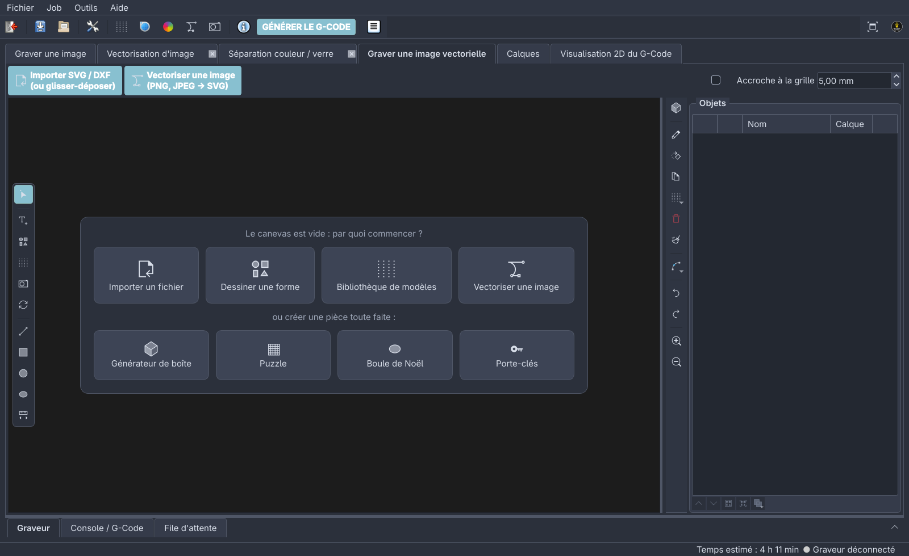
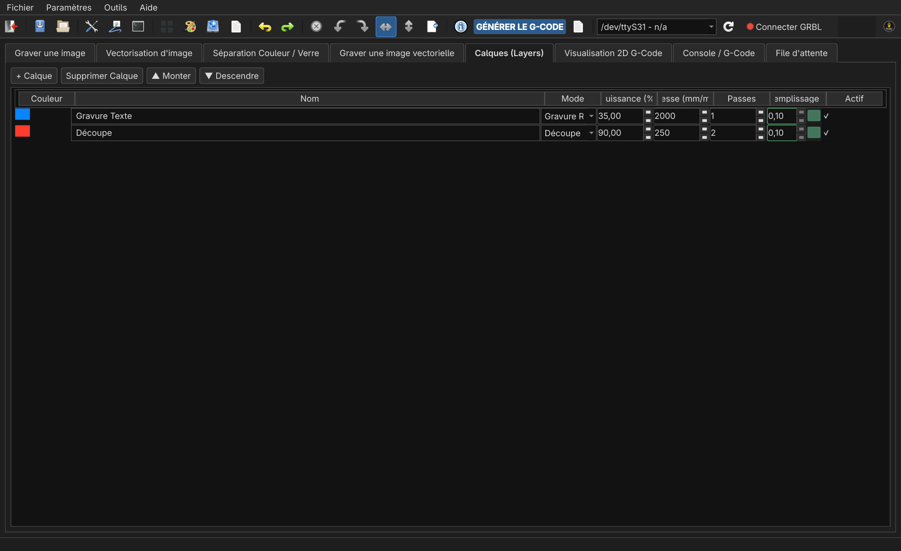
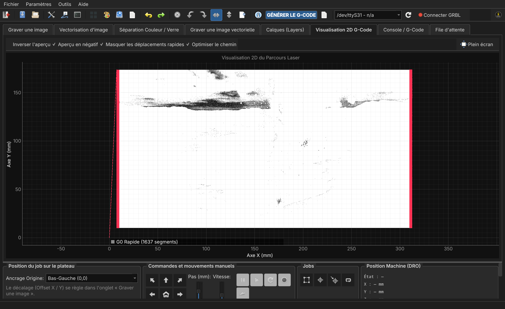
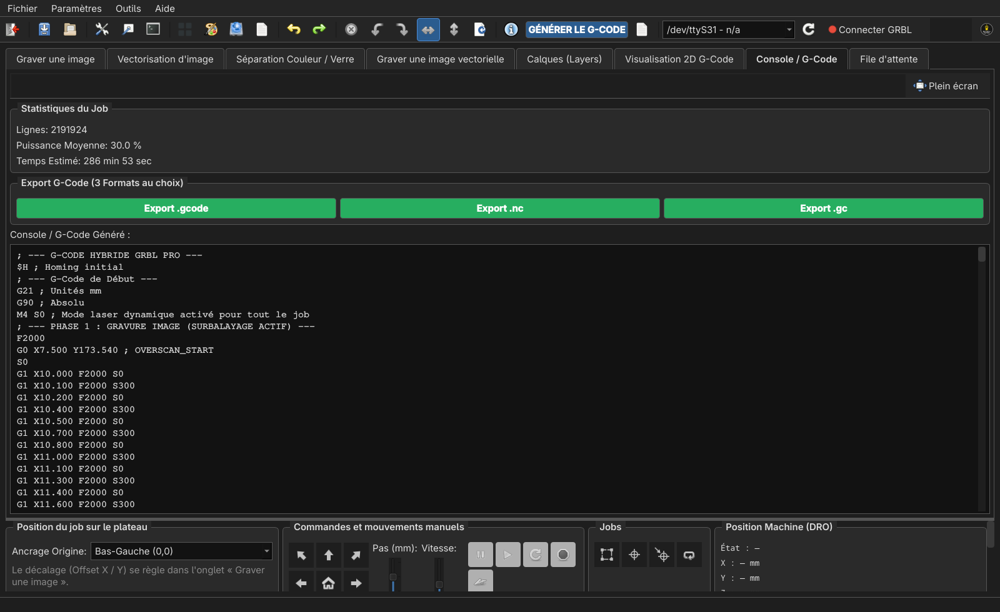
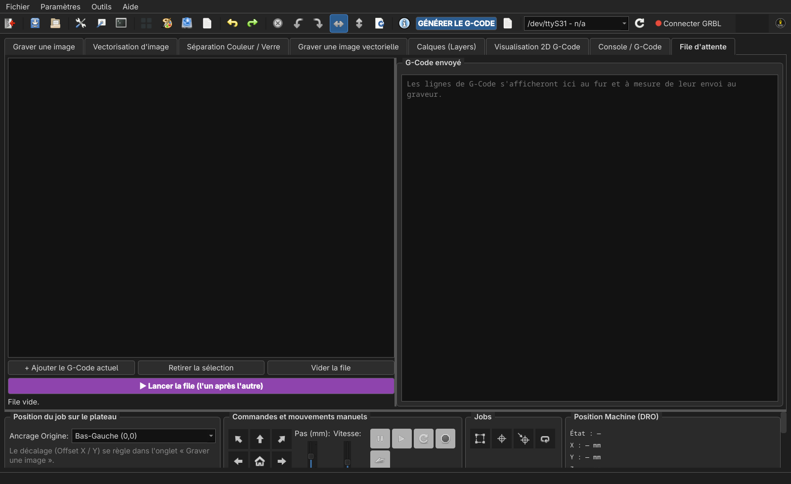
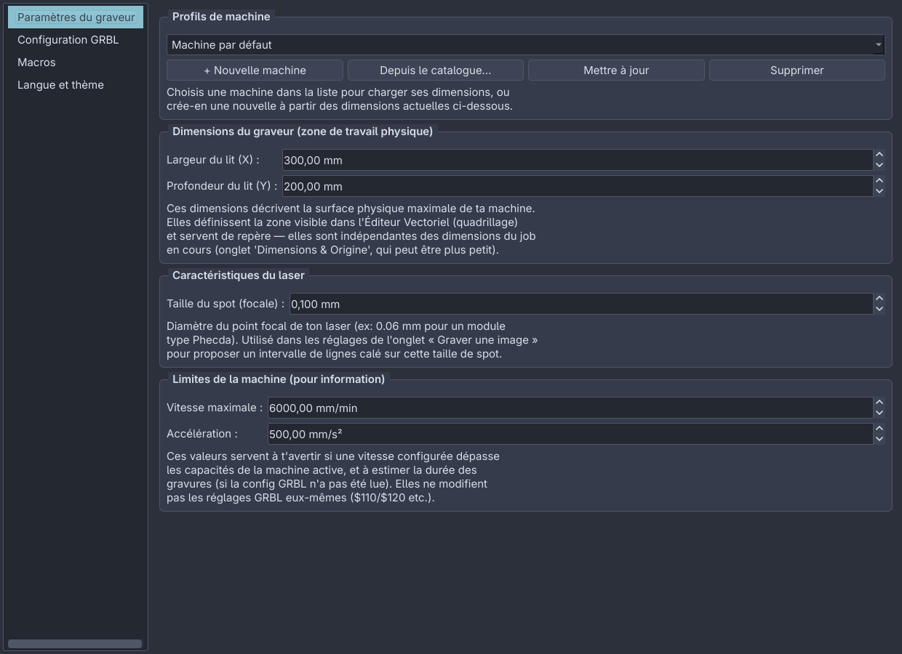
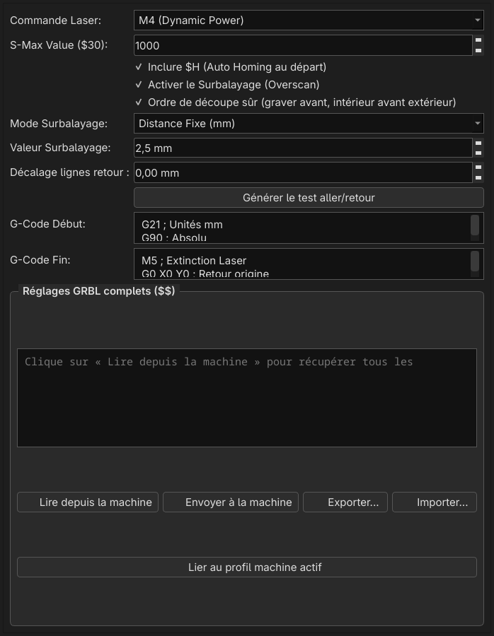
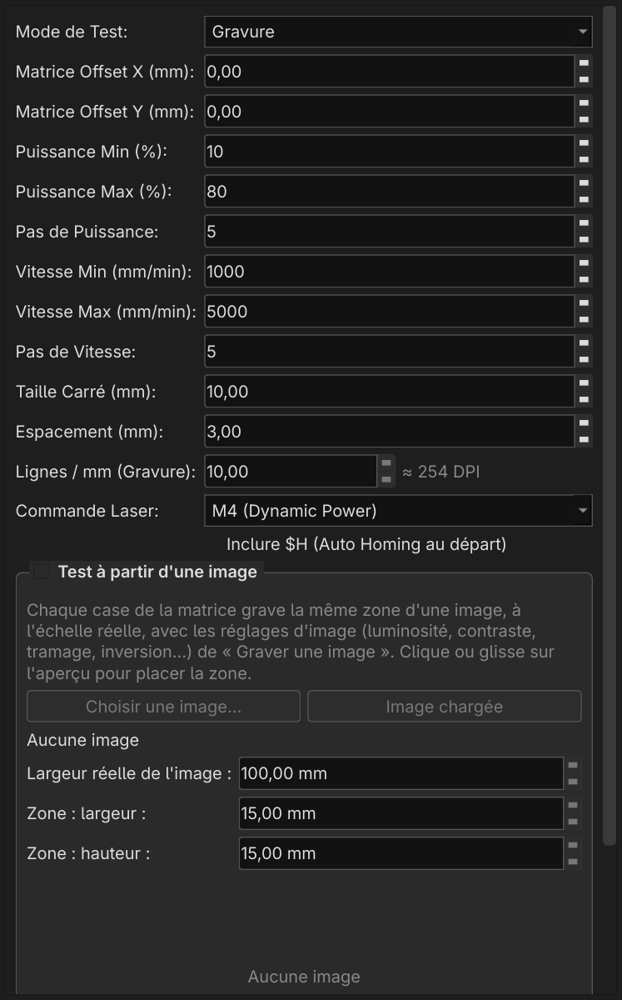

# Laser Studio Pro

[](https://ko-fi.com/jb3dlaser)

Laser Studio Pro est un logiciel de pilotage GRBL pour graveur et découpeuse laser, avec :
- gravure d’images (tramage, niveaux de gris, résolution liée à la taille du spot),
- sélecteur de matière (fond noir / fond clair) pour graver en négatif ou en positif,
- séparation couleur / verre (calque noir à graver, calque couleur à imprimer, simulation du rétro-éclairage, PDF à l’échelle 1:1),
- découpe/gravure vectorielle, import SVG et DXF, conversion PNG/JPEG → SVG,
- générateur de boîte à encoches (dimensions X/Y/Z, décor texte ou SVG),
- gestion de calques, avec leurs réglages mémorisés par machine,
- calibrage guidé : matrice de test, décalage aller/retour et gain de point pour le verre,
- génération et aperçu 2D du G-Code, file d’attente de jobs,
- profils machine (dimensions, focale, réglages GRBL, matériaux),
- export/import de projets, sauvegarde automatique,
- support multilingue (Français, English, Deutsch, Español).

L’historique détaillé des versions est dans [`CHANGELOG.md`](CHANGELOG.md).

## Installation

### Fedora (Copr)

Sous Fedora 43, 44 et 45 (x86_64 et aarch64), Laser Studio Pro s’installe depuis le dépôt [Copr](https://copr.fedorainfracloud.org/coprs/alemorvan/laser-studio-pro/), avec les bibliothèques de Fedora :

```bash
sudo dnf copr enable alemorvan/laser-studio-pro
sudo dnf install laser-studio-pro
```

L’application apparaît dans le menu des applications (Stencil Studio par un clic droit sur son icône) et se lance aussi avec `laser-studio-pro`. Les mises à jour arrivent avec celles du système. La détection du sujet par IA de Stencil Studio est facultative : `sudo dnf install --setopt=install_weak_deps=False python3-onnxruntime`. L’accès au port série demande d’appartenir au groupe `dialout` (voir plus bas).

### Debian et Ubuntu (.deb)

Sous Debian 13 (trixie) ou Ubuntu 25.04 et plus récentes, téléchargez `laser-studio-pro_<version>_all.deb` sur la page des [releases](https://github.com/Jgood3d/laser-studio-pro/releases), puis :

```bash
sudo apt install ./laser-studio-pro_<version>_all.deb
```

Le paquet utilise les bibliothèques Python du système (PyQt6, OpenCV, NumPy…) et installe l’entrée de menu. Ubuntu 24.04, trop ancienne pour PyQt6 6.7, utilise l’AppImage. Construction et choix du paquet : `packaging/debian/README.md`.

### Avec pip (Windows, Linux, macOS)

Python 3.10 à 3.14 convient : le Python fourni par la distribution suffit (Ubuntu 22.04 et suivantes, Debian 12 et 13, Fedora récentes). Installez les dépendances selon votre système :

```bash
pip install -r requirements-windows.txt    # Windows
pip install -r requirements-linux.txt      # Linux
```

`numba` est optionnel : il accélère le tramage, l’application fonctionne sans (mais le tramage est environ cent fois plus lent).
Sous Linux, l’utilisateur doit appartenir au groupe `dialout` pour accéder au port série. Ajoutez-le au groupe :

```bash
sudo usermod -aG dialout $USER
```

Fermez puis rouvrez la session pour que l’appartenance au groupe soit prise en compte (vérifiez ensuite avec `groups`).

### Installation dans un environnement virtuel (recommandé)

Un environnement virtuel isole les dépendances du projet de celles du système. Depuis le dossier du projet, créez-le, activez-le puis installez les dépendances :

```bash
python3 -m venv .venv
source .venv/bin/activate
pip install -r requirements-linux.txt
```

Sous Debian et Ubuntu, le module `venv` est un paquet à part : `sudo apt install python3-venv`.

> **Note** : les dépendances (numpy 2) acceptent Python 3.10 à 3.14 ; pip choisit lui-même la version de numpy adaptée au Python installé. Un environnement mélangeant deux versions de Python provoque l’erreur `ModuleNotFoundError: No module named 'PyQt6'` alors que PyQt6 est installé : en cas de doute, supprimez `.venv` et recréez-le.

L’environnement doit être activé (`source .venv/bin/activate`) dans chaque nouveau terminal avant de lancer l’application. Pour en sortir, utilisez `deactivate`.

## Lancer l’application

Lancez `main.py` depuis le dossier du projet.

```bash
source .venv/bin/activate
python main.py
```

Au démarrage, un avertissement de sécurité demande une confirmation. Sa case « Ne plus afficher à chaque démarrage » le limite à un rappel tous les 30 démarrages. Pour les tests et le développement, la variable d’environnement `NOWARNING` le désactive complètement :

```bash
NOWARNING=1 python main.py
```

## Structure du projet

Le code suit la disposition `src/` recommandée pour les projets Python (voir `pyproject.toml`) :
- `src/laser_studio/` — l’application Laser Studio ; les chemins ci-dessous lui sont relatifs ;
- `src/laser_common/` — code partagé par Laser Studio et Stencil Studio, indépendant des deux (`files.py` : écriture sûre des fichiers de données) ;
- `src/stencil_studio/` — Stencil Studio, sous-application ouverte depuis le menu Outils (ou seule, dans le navigateur : `cd src && python -m stencil_studio`). Calcul (`core/`, un module par métier…), modèles (`models/`), contrôleurs (`controllers/`), interface (`ui/` : page web, fenêtre Qt), serveur local (`server.py`) ;
- `tests/`, `tools/`, `packaging/`, `docs/` à la racine du dépôt.

On lance l’application avec `python main.py` depuis le dépôt, ou `python -m laser_studio` après `pip install -e .`.

### Point d’entrée
- `main.py` (racine du dépôt) — lance l’application sans installation ; `main.py` dans `src/laser_studio/` contient le démarrage (`main()`)
- `core/` — socle sans interface : `version.py` (version de l’application), `paths.py` (chemins, ressources), `constants.py` (valeurs fixes : liens, tailles), `debug_log.py` (journal de débogage de la gravure)
- `models/` — modèles de données, des `QObject` qui préviennent de chaque changement par des signaux : `layers.py` (`LayersModel` : la liste des calques et leurs réglages ; chaque modification est écrite dans le journal de débogage avec l’ancienne et la nouvelle valeur), `machine.py` (`MachineConfig` : plateau, spot, limites), `grbl.py` (`GrblConfig` : commande laser, S-Max, homing, surbalayage, G-Code de début et de fin, réglages `$$`), `materials.py` (`MaterialsModel` : les matériaux et le matériau choisi, qui suit chaque changement de calque), `image_settings.py` (`ImageSettings` : réglages de tramage de « Graver une image », et `ImageSettingsHistory`, leur annulation), `settings.py` (base des réglages nommés), `layer_modes.py` (codes des modes de calque, `engrave_fill` / `cut` / `mark`, et conversion des anciens libellés français), `change_log.py` (journal : une ligne par changement, une seule à la fin d’une saisie au clavier) ; les champs des pages de réglages y sont liés par `ui/binding.py`

### Composants autonomes
- `ui/vector_editor/` — éditeur vectoriel : canevas `VectorCanvasView` et ses outils de la souris (`tools/`), liste des objets à droite (`objects_panel.py`, `ObjectsPanel` : ordre, groupes, opérations booléennes), menu du clic droit (`context_menu.py`), boîtes de saisie (texte, médaille, forme, calque, taille du groupe) ; objets du dessin dans `models/vector_objects.py` (dont `GroupObject`, groupe qui garde ses objets ; opérations booléennes dans `vector/boolean_ops.py`)
- `grbl/` — dialogue avec le graveur, sans Qt : `connection.py` (`LaserUSBController`, connexion série), `streaming.py` (envoi d'un job : tampon de GRBL, lecture des réponses), `macros.py` (macros de l'utilisateur : macros.yaml) et `simulator.py` (`SimulatedGrblSerial`, graveur simulé de `LASER_STUDIO_SIMULATION`)
- `controllers/workers.py` — threads (QThread) : traitement de l’image (calcul dans `image/dithering.py`), envoi du G-Code, génération dans un thread
- `ui/widgets/` — petits widgets réutilisables : `ZoomableGraphicsView`, `HistoryLineEdit` (historique de commandes), `AutoHideLabel` (libellé à masquage automatique), `FloatingToolBar` (barre flottante posée sur une zone, en haut, en bas, à gauche ou à droite : actions image, comparaison des tramages et image originale, options de l’aperçu 2D, calques, édition et alignement de l’éditeur vectoriel ; annuler / refaire puis les loupes toujours au bout à droite), `TabCloseButton` (croix d’un onglet), `FullscreenWindow` (fenêtre « Plein écran » qui accueille un onglet), `SliderWithButtons` (curseur entre deux boutons « - » / « + », avec sa valeur)
- `ui/fonts.py` — polices embarquées (`resources/fonts/`, licences libres), enregistrées au démarrage pour être disponibles sur tous les systèmes (Dancing Script, police manuscrite, et Rubik, titres des médailles et des totems, pour les modèles de la bibliothèque)
- `ui/utils.py` — utilitaires partagés par les éléments d’interface (icônes dessinées, images nettes en haute résolution)
- `ui/splashscreen/` — `StartupSplash`, écran de démarrage (affichage réel sous Wayland, durée minimale)
- `ui/app/qt_messages.py` — filtre des avertissements de Qt sans conséquence (Wayland)
- `ui/app/theme.py` — thèmes de l’interface (sombre, clair, Dusk, Warm : palette et feuille de style), pack d’icônes Breeze embarqué
- `image/` — traitement d’image sans Qt : `dithering.py` (taille de gravure, tons, netteté, négatif et tramage de l’image à graver ; vignettes de comparaison), `gain_test.py` (grille du test du gain de point), `filters.py` (netteté), `size.py` (taille d’origine d’après la résolution), `resolution.py` (lignes/mm, DPI, focale et qualité de l’écart entre les lignes), `matrix.py` (matrice de test à partir d’une image), `separation.py` (calculs de séparation couleur / verre), `vectorize.py` (conversion PNG/JPEG → SVG)
- `vector/` — géométrie vectorielle :
  - `vector/boolean_ops.py` — opérations booléennes des groupes de l’éditeur (union, différence, intersection, exclusion), sans widget
  - `vector/svg_tree_import.py`, `vector/svg_style.py` — import SVG du bouton « Importer », conforme à la spécification : groupes et textes gardés, calque d’après la couleur, objets blancs et cachés sur le calque « Ignoré »
  - `vector/order.py` — ordre de découpe sûr (gravure avant découpe, intérieur avant extérieur)
  - `vector/nesting.py` — imbrication automatique des pièces sur une feuille (sans Qt) ; `vector/nesting_apply.py` reporte le résultat sur les objets (sans canevas)
  - `vector/nudge.py` — pas de déplacement aux flèches du clavier (sans Qt)
  - `vector/text_follow.py` — texte posé sur le contour d’un objet, textes de médaille
  - `vector/group_transform.py` — sélection traitée comme un groupe (redimensionner, quart de tour, calque)
  - `vector/dxf.py` — lecteur DXF texte (sans Qt, sans dépendance)
  - `vector/box_generator.py` — calcul des panneaux d’une boîte à encoches (sans Qt)
  - `vector/importers.py` — passerelle vers les objets de l’éditeur vectoriel (DXF, boîte, décor)
  - `vector/svg_import.py` — modèles de la bibliothèque : options en sous-calques, textes remplaçables (même dans un masque), aperçu de la fiche ; l’import passe par `vector/svg_tree_import.py` (`import_library_svg`), comme le bouton « Importer »
  - `vector/font.py` — `VectorFont`, police vectorielle des étiquettes texte
- `i18n/` — système de traduction multilingue : `texts/` (les textes dans chaque langue, un module par zone : app, vector, box, ornament, generators, camera, image, machine, materials), `translations.py` (les assemble), `errors.py` (message d'une erreur de générateur), `language.py` (langue choisie, `tr()`)

### Fenêtre principale
- `ui/app/main_window.py` — fenêtre principale, sans mixin : assemblage (modèles, contrôleurs partagés, builder de chaque partie de l’interface, objets de `ui/app/`), fermeture, glisser-déposer, messages
- `ui/…/builder.py` — un builder par partie de l’interface (onglets, éditeur vectoriel, panneau machine, pages de réglages) : crée la vue et sa logique et les relie, avec ses dépendances en paramètres
- `ui/statusbar/` — barre d’état (`StatusBar` : messages d’information, progression de la génération)
- `ui/app/menu/` — menu et barre d’outils : `AppActions` (toutes les actions et leurs signaux), `AppMenuBar` et un fichier par menu (Fichier, Paramètres, Affichage, Outils, Aide), `AppToolBar`
- `controllers/window.py` — contrôleur de la fenêtre (`WindowController`), qui fait ouvrir ses fenêtres par `ui/app/window_forms.py` (`WindowForms`) : abonnement aux signaux du menu et de la barre d’outils, thème, langue, aide, caméra, fenêtres de réglages, résolution et focale, Stencil Studio
- `ui/app/window_state.py` — ce que la fenêtre enregistre et restaure (`WindowState`) : réglages machine, champs d’un profil machine, état d’un projet, recopie automatique des calques dans le matériau choisi
- `ui/app/tabs.py` — onglets du centre (`MainTabs`) : affichage, onglets facultatifs du menu Affichage, plein écran, panneau du bas, séparateurs mémorisés
- `ui/app/job_display.py` — affichage des résultats du job et de l’état du graveur (`JobDisplay`) : console, statistiques, aperçu 2D, position, suivi de l’envoi
- `ui/app/image_actions.py` — « Pivoter », « Supprimer » et miroirs de la barre d’outils, sur l’image de l’onglet affiché (`ImageToolbarActions`)
- `ui/about/` — boîte « À propos » (`AboutDialog`, `AboutBannerPixmap`, `AboutLabel`)
- `ui/support/` — boîte « Support » (`SupportDialog`, `SupportLabel`)
- `ui/buy_me_a_coffee/` — boîte « Buy me a coffee » (`BuyMeACoffeeDialog`, `BuyMeACoffeeLabel`) et bouton ko-fi de la barre d’outils (`BuyMeACoffeeButton`)
- `ui/machine/` — `MachinePanel`, panneau machine sous les onglets : assemble le G-Code envoyé, la connexion, le pilotage et les actions de job, puis la barre de progression ; `set_status(état, x, y, z)` répartit l’état (cadre Connexion) et la position (sous le pilotage)
- `ui/machine/connection/` — panneau « Connexion » `ConnectionPanel` : port (modèle partagé avec la page des matériaux), actualisation, connexion, état GRBL et console directe (émet `refresh_requested`, `connect_requested`, `unlock_requested`, `command_submitted`)
- `ui/machine/status/` — `MachineStateView` (état GRBL coloré, « Déverrouiller » en alarme) et `AxisPositionRow` (X / Y / Z sur une ligne, sous le pilotage)
- `ui/machine/controls/` — panneau de pilotage `JogControlPanel` : jog, homing, curseurs de pas et de vitesse, commandes temps réel, envoi du job (émet des signaux) ; les commandes temps réel et l’envoi du job sont `RealtimeCommands`
- `ui/machine/job_actions/` — panneau `JobActionsPanel` : cadrage, zéro, aller au zéro, répétition (émet des signaux ; accueillera les macros)
- `ui/machine/console/` — console directe `DirectConsolePanel` (sans cadre, dans le panneau Connexion) : commande GRBL tapée à la main, historique (émet `command_submitted`)
- `ui/settings/machine_params/` — page « Paramètres du graveur » `MachineParamsPage` : profils machine, lit, spot, limites (émet `focal_changed`, `bed_size_changed`…)
- `ui/settings/grbl_config/` — page « Configuration GRBL » `GrblConfigPage` : commande laser, surbalayage, décalage aller/retour, G-Code de début et de fin, réglages GRBL complets (émet `read_settings_requested`, `scan_offset_changed`…) ; le cadre « Réglages GRBL complets » est `GrblSettingsBox`
- `ui/settings/test_matrix/` — page « Matrice de test » `TestMatrixPage` : réglages de la grille, test à partir d’une image avec l’aperçu `TilePicker` (émet `generate_requested`…, fournit `matrix_params()`) ; le cadre « Test à partir d’une image » est `ImageTestGroup`
- `ui/tabs/image/` — onglet « Graver une image » `ImageTab` : réglages `ImageSettingsPanel` (taille et décalage, réglages photo, matière `MaterialComboBox`, tramage, résolution `ResolutionBox`), aperçus originale / tramé (émet `compare_requested` ; le panneau émet `processing_changed`, `size_changed`, `resolution_changed`…), affiche ce que lui envoie `ImageController` (`controllers/image.py` : image source, taille, tramage dans un thread, comparaison des algorithmes)
- `ui/machine/job_position/` — cadre « Position du job » `JobPositionBox` (origine du repère, `origin()` / `set_origin()`), à droite de l’aperçu 2D
- `ui/machine/sent_gcode/` — suivi du G-Code envoyé `SentGcodeLog` (file et envoi direct), à gauche du panneau machine
- `ui/tabs/png2svg/` — onglet « Vectorisation d’image » `Png2SvgTab` : widget de conversion PNG/JPEG → SVG `PngToSvgWidget` (utilise le module `converter`) et son aperçu `ZoomableSvgView` (émet `send_to_vector_requested`, `image_changed`)
- `ui/tabs/separation/` — onglet « Séparation Couleur / Verre » `SeparationTab` : plaque, recadrage, calques noir et couleur, simulation, aperçus, glisser-déposer (émet `tone_changed`, `preview_changed`, `image_dropped`…), affiche ce que lui envoie `SeparationController` (`controllers/separation.py` : image source, tonalité envoyée à « Graver une image », calque couleur, aperçus, export, réglages du verre) ; réglages dans `models/separation.py` (`SeparationSettings`)
- `ui/tabs/preview_2d/` — onglet « Visualisation 2D G-Code » `Preview2DTab` : graphique de l’aperçu du G-Code (modèle `gcode/preview.py`), point de position de la tête, traits déjà gravés en rouge pendant un job, options d’affichage (émet `plot_clicked` en mm, `display_options_changed`), et à droite une colonne étroite : `JobPositionBox`, puis `JobStatsPanel` : lignes, puissance moyenne et temps estimé du job (`set_stats`)
- `ui/tabs/console/` — onglet « Console / G-Code » `ConsoleTab` : console du G-Code généré ou importé (les messages vont dans la barre d’état) ; affiché ou masqué par le menu Affichage ou sa croix (`TabCloseButton`), choix mémorisé
- `ui/tabs/job_queue/` — onglet « File d’attente » `JobQueueTab` (affiché ou masqué par le menu Affichage, le bouton de la barre d’outils ou sa croix, choix mémorisé) : jobs à enchaîner (émet `run_requested`, `reordered`…) ; le G-Code envoyé est suivi dans le panneau machine (`SentGcodeLog`)
- `ui/tabs/layers/` — onglet « Calques » `LayersTab` : barre des profils matériaux (liste, nouveau, supprimer, exporter, importer ; pas de bouton « Enregistrer », le matériau choisi suit chaque changement de calque ; un matériau mémorise les réglages des calques, voir `controllers/materials.py`), puis la liste des calques (`LayerManagerWidget`, `ui/tabs/layers/layer_table.py`, vue abonnée au modèle `LayersModel`), dont il relaie `layers_changed`
- `controllers/vector_editor.py` — actions de l’éditeur vectoriel (`VectorEditorController` : import SVG / DXF et placement, insertion, alignement) sur le modèle `models/vector_document.py` ; le canevas et le panneau des propriétés sont dans `ui/vector_editor/`, les fenêtres de saisie derrière `ui/vector_editor/forms.py` (`EditorForms`)
- `gcode/stats.py`, `models/job_history.py`, `controllers/job_history.py`, `ui/dialogs/job_history/` — historique des gravures (Outils › Historique des gravures…) : chaque job envoyé, durée réelle et estimée, issue, statistiques du G-Code
- `controllers/generators.py` — générateurs (`GeneratorsController` : boîte, puzzle, boules de Noël, porte-clés, gabarit) ; `controllers/layout.py` — imbrication et duplication en série (`LayoutController`)
- `gcode/` — génération du G-Code sans Qt (job, image, découpe SVG, calques vectoriels, matrice de test, motif aller/retour) et modèle de l’aperçu 2D (`preview.py`) ; `controllers/job.py` (`JobController`) prépare et lance le job, exporte et importe le G-Code
- `controllers/engraver.py` — pilotage du graveur (`EngraverController` : ports, connexion, jog, cadrage, envoi des jobs, configuration `$$`) ; commandes GRBL dans `grbl/commands.py` (sans Qt) ; le dialogue avec GRBL (port série, threads) est dans `controllers/machine_connection.py`
- `controllers/` — contrôleurs, objets Python ordinaires qui ont remplacé les mixins : `machine_connection.py` (`MachineConnection` : port série, threads de dialogue avec GRBL, état « référencé », lecture de `$$`, envoi du job ; sans boîte de dialogue, la fenêtre s’abonne à ses signaux), `png2svg.py` (`Png2SvgController` : SVG de l’onglet PNG→SVG vers l’éditeur vectoriel), `matrix_image.py` (`MatrixImageController` : matrice de test à partir d’une image), `job_queue.py` (`JobQueueController` : file d’attente de jobs, et `Engraver`, ce que la file demande au graveur), `machine_profiles.py` (`MachineProfilesController` : profils machine, leurs actions et la mémoire continue des calques ; chaque page fournit ses champs par `profile_values()` / `apply_profile_values()`), `layer_memory.py` (mémoire des calques par machine : réglages des calques enregistrés dans chaque profil et réappliqués au modèle des calques), `materials.py` (`MaterialsController` : profils matériaux, et la liste par défaut `DEFAULT_MATERIALS_DB`), `project.py` (`ProjectController` : enregistrement et ouverture de projet, projets récents, sauvegarde automatique ; l’état du projet est lu et réappliqué par `WindowState`, `capture_project` / `restore_project` dans `ui/app/window_state.py`)
- `ui/dialogs/box_generator/` — fenêtre du générateur de boîte `BoxGeneratorDialog`
- `library/machine_catalog.py`, `resources/machines/`, `ui/dialogs/machine_catalog/` — catalogue des machines (Paramètres du graveur › Depuis le catalogue…) : graveurs GRBL du commerce avec les valeurs publiées par leur constructeur et leurs sources, un YAML par marque ; crée un profil machine
- `library/catalog.py`, `controllers/library.py`, `ui/dialogs/library/` — bibliothèque de modèles (Outils → Bibliothèque…) : catalogue des dossiers `resources/library/<catégorie>/<modèle>/` (sans Qt), `LibraryController` (ouverture et import sur les calques de même rôle), fenêtres `LibraryDialog` (grille, catégories, recherche, taille des aperçus) et `LibraryItemDialog` (fiche : aperçu, dessin, variantes, readme). Comment ajouter un modèle : `resources/library/README.md`
- `nesting_apply.py`, `ui/dialogs/nesting/` — imbrication dans l’éditeur vectoriel (objets ⇄ algorithme, sans canevas, et fenêtre de réglage `NestingDialog`)
- `ui/dialogs/dither_comparison/` — fenêtre de comparaison des algorithmes de tramage `DitherComparisonDialog` (vignettes calculées par `image/dithering.comparison_thumbnails`, via `ImageController.comparison`)
- `ui/settings/window.py` — `SettingsWindow`, fenêtres « Paramètres du graveur », « Configuration GRBL » et « Matrice de test » ouvertes depuis les menus

### Signaux des pages et des panneaux

Les pages, onglets et panneaux de `ui/` ne contiennent pas de logique : ils émettent des signaux (ce que l’utilisateur demande, avec des valeurs métier : mm, mm/min, %), et reçoivent leur état par des méthodes `set_…`. La fenêtre (`main_window.py`) les construit et abonne la logique à leurs signaux.

Nommage : un signal de demande `x_requested` appelle la fonction `x()` (`save_project_requested` → `save_project`, `emergency_stop_requested` → `emergency_stop`) ; un signal d’état `y_changed` ou `y_selected` appelle `_on_y_changed()` ou une fonction qui dit ce qu’elle fait (`profile_selected` → `_on_machine_profile_selected`). La carte `docs/architecture/signaux.png` (`tools/signal_map.py`) montre toutes les paires.

**Pages de réglages** (menu Paramètres, `ui/settings/`) :

| Page | Signaux émis | État reçu / lu |
| --- | --- | --- |
| `MachineParamsPage` — Paramètres du graveur | `profile_selected(int)`, `new_profile_requested`, `update_profile_requested`, `delete_profile_requested`, `bed_size_changed(largeur_mm, profondeur_mm)`, `focal_changed(spot_mm)`, `max_speed_changed(mm_min)` | champs `profile_combo`, `bed_width_spin`, `bed_height_spin`, `focal_spin`, `max_speed_spin`, `accel_spin` |
| `TestMatrixPage` — Matrice de test | `generate_requested`, `choose_image_requested`, `use_loaded_image_requested`, `image_test_toggled(bool)` | `set_lines_mm()`, `set_source_image()`, `set_image_test_checked()` ; fournit `matrix_params()`, `tile_settings()`, `is_engraving()`, `image_test_enabled()` |
| `GrblConfigPage` — Configuration GRBL | `bidir_test_requested`, `scan_offset_changed(mm)`, `read_settings_requested`, `send_settings_requested`, `export_settings_requested`, `import_settings_requested`, `link_settings_to_profile_requested` | champs `laser_cmd_combo`, `smax_spin`, `homing_check`, `overscan_check`, `overscan_mode_combo`, `scan_offset_spin`, `grbl_settings_edit`… |

**Onglets** (`ui/tabs/`) :

| Onglet | Signaux émis | État reçu / lu |
| --- | --- | --- |
| `ImageTab` — Graver une image | `compare_requested`, `crop_requested` | `settings` (le panneau ci-dessous), `source_view`, `dither_view`, `fit_settings_width()` ; barre flottante à gauche `view_toolbar` (`compare_action`, `show_original_action`) |
| `ImageSettingsPanel` — réglages de « Graver une image » | `load_requested`, `processing_changed`, `material_changed("dark" / "light")`, `size_changed(axe, mm)`, `resolution_mode_changed(int)`, `lines_per_mm_changed(float)`, `dpi_changed(float)`, `configure_focal_requested`, `save_as_focal_requested`, `undo_requested`, `redo_requested` | champs `width_spin`, `height_spin`, `brightness_slider`, `algorithm_combo`, `lines_per_mm_spin`, `resolution_stack`… |
| `Png2SvgTab` — Vectorisation d’image | `send_to_vector_requested(svg)`, `image_changed` | `converter` (widget de conversion : `image_path`, `rotate_image()`, `clear_image()`) |
| `LayersTab` — Calques | `layers_changed` | `refresh()`, `refresh_focal_quality()`, `link_all_to_focal()` |
| `Preview2DTab` — Visualisation 2D G-Code | `display_options_changed`, `plot_clicked(x_mm, y_mm)` | `plot_widget` (la génération y dessine), `position_marker`, cases `flip_check`, `negative_check`, `hide_rapid_check`, `optimize_path_check` |
| `ConsoleTab` — Console / G-Code | (aucun) | `console_edit` |
| `JobQueueTab` — File d’attente | `add_current_requested`, `remove_selected_requested`, `clear_requested`, `run_requested`, `reordered` | `add_job()`, `set_jobs()`, `job_names()`, `set_status()`, `set_run_enabled()` |

**Panneau machine** (sous les onglets, `ui/machine/`) :

| Panneau | Signaux émis | État reçu |
| --- | --- | --- |
| `JogControlPanel` — pilotage, position X / Y / Z en bas | `jog_requested(dx_mm, dy_mm, vitesse_mm_min)`, `home_requested`, `pause_requested`, `resume_requested`, `reset_requested`, `emergency_stop_requested`, `send_job_requested` | `set_connected(bool)`, `set_send_enabled(bool)`, `set_max_speed(mm_min)`, `set_position(x, y, z)` |
| `JobActionsPanel` — actions de job | `frame_requested`, `set_work_zero_requested`, `go_to_work_zero_requested`, `repeat_job_requested` | `set_connected(bool)`, `set_repeat_enabled(bool)` |
| `ConnectionPanel` — connexion, état GRBL, console directe | `refresh_requested`, `connect_requested`, `unlock_requested`, `command_submitted(commande)` | `set_connected(bool)`, `set_state(état)`, `ports_combo` |
| `DirectConsolePanel` — console directe (dans Connexion) | `command_submitted(commande)` | `set_connected(bool)` |
| `JobPositionBox` — position du job (à droite de l’aperçu 2D) | (aucun : l’origine est lue à la génération) | `origin()`, `set_origin(code)` |
| `SentGcodeLog` — G-Code envoyé | (aucun) | `clear_lines()`, `append_lines(lignes)`, `mark_end(terminé)` |
| `MachinePanel` — assemble les panneaux ci-dessus | (ceux de ses panneaux) | `set_connected(bool)`, `set_status(état, x, y, z)` |

**Boîtes et fenêtres** (`ui/dialogs/`, `ui/widgets/`) :

| Fenêtre | Signaux émis | État reçu |
| --- | --- | --- |
| `DitherComparisonDialog` — comparaison des algorithmes de tramage | `algorithm_chosen(nom)` | vignettes tramées, à la construction |
| `FullscreenWindow` — plein écran d’un onglet | `content_released` (le contenu retourne dans les onglets) | le contenu, à la construction ; `show_maximized()` |

Le menu et la barre d’outils de la fenêtre passent par `AppActions` (`ui/app/menu/actions.py`), qui émet un signal par action : `save_project_requested`, `settings_window_requested(page)`, `theme_selected(code)`, `generate_requested`, `gcode_export_requested(extension)`, `gcode_console_toggled(bool)`, `puzzle_generator_requested`…

### Qualité
- `tests/` — tests automatiques (G-Code, fin de job, calibrage, séparation couleur/verre, sauvegardes, reset/référencement, calques par machine, traductions)
- `tools/check_translations.py` — rapport sur les traductions (clés inutilisées, textes en dur, registre tu/vous)
- `tools/check_ui_attributes.py` — détecte les widgets utilisés mais jamais construits (fichier resté à l’ancienne version)
- `tools/signal_map.py` — carte des signaux (qui émet quoi, qui branche, quelle fonction s’exécute), dans `docs/architecture/signaux.svg` et `.png`
- `tools/screenshots.py` — captures d’écran de tous les onglets, pages de réglages et boîtes de dialogue, dans `docs/screenshots/`

## Captures d’écran


Conversion PNG → SVG :


Déplacement d’un SVG sur le plan de travail :


Interface en anglais et en allemand :


## Nouveautés de la version 2.5.0

- **Stencil Studio** : un nouvel espace de travail pour créer et optimiser des pochoirs et des designs vectoriels ou matriciels, accessible par un bouton de la barre de menus :
  - **trame par point et par ligne** : les images deviennent des motifs de points ou de lignes prêts à graver ;
  - **effet Low Poly** : les images deviennent des compositions de polygones ;
  - **générateur de boîte avec éclairage** : boîtier sur mesure avec logements pour les LED et l'alimentation, assemblé par encoches ;
  - export direct vers Laser Studio Pro.
- **Barre de menus réorganisée** pour accéder rapidement aux différents studios et aux réglages.

Précédemment, dans la version 2.4.0 :

- **Imbrication automatique** : range les pièces sur une feuille pour gaspiller le moins de matière possible (rotations, écart, marge, emboîtement dans les creux ; les trous et détails suivent leur pièce).
- **Ordre de découpe sûr** : graver avant de découper, et couper l’intérieur avant l’extérieur, pour qu’une pièce ne bouge pas avant que ses détails soient faits.
- **Netteté** dans les réglages photo : accentue les contours avant le tramage.
- **Menus de réglages** (Paramètres Machine, Machine & Profils, Configuration GRBL, Matrice de test), **image insérée à sa taille d’origine**, **flèches du clavier** dans l’éditeur vectoriel et homing automatique activé par défaut.
- **Remplissage vectoriel corrigé** : plus de vides aux croisements de traits, et le décalage aller/retour s’applique aussi aux remplissages (contours moins en escalier).

Précédemment, dans la version 2.3.0 :

- **Import DXF** dans l’éditeur vectoriel (lignes, polylignes, cercles, arcs, ellipses, splines, blocs), avec réunion automatique des segments en contours.
- **Générateur de boîte à encoches** : panneaux prêts à découper, avec décor texte ou SVG gravé sur les faces.
- **Décalage aller/retour** : corrige le flou des contours verticaux de la gravure d’image, avec un motif de test pour trouver la bonne valeur (mémorisée par machine).
- **Assistant de calibrage du gain de point** pour la gravure sur verre : une grille à graver pour régler le curseur au bon endroit.
- **Fin de job fiable** : l’application attend que la machine soit réellement à l’arrêt (état Idle), et un Reset n’est plus annoncé comme une fin normale.
- **Sauvegardes en arrière-plan** : l’autosave et la file d’attente ne figent plus l’interface.
- **Boîtes de dialogue de l’éditeur vectoriel traduites**, et tutoiement harmonisé dans toutes les langues.

Précédemment, dans la version 2.2.0 :

- **Sélecteur « Matière »** (Image / Filtres) : fond noir ou fond clair, qui coche ou décoche « Inverser Couleurs » ; la matière est rappelée dans l’alerte avant gravure et enregistrée dans le projet.
- **Réglages des calques mémorisés par machine** : vitesse, puissance, passes… retrouvés à la réouverture, propres à chaque profil machine.
- **Séparation Couleur / Verre** : calque noir, calque couleur, simulation et PDF d’impression à l’échelle 1:1.
- **Correction importante de la gravure d’image** : le G-Code appliquait la puissance au mauvais segment ; régénérez les G-Codes d’image créés avec une version antérieure.
- **Reset / arrêt d’urgence** : le statut « référencé » est retiré si la machine n’était pas à l’arrêt, un nouveau homing est demandé.
- **Sauvegardes atomiques** (autosave, file d’attente, projet) : plus de fichier tronqué en cas de plantage.

Voir [`CHANGELOG.md`](CHANGELOG.md) pour le détail et les versions précédentes.

## Compilation (PyInstaller)

Les scripts de compilation sont dans `packaging/` : `windows/build.bat` (et `windows/setup.iss` pour l’installateur), `linux/build-linux.sh` et `macos/build_macos.sh`. Le détail est dans [`BUILD.md`](BUILD.md).

Les images de l’application sont dans le dossier `resources/` : `laser_studio_pro.ico` (ou `laser_studio_pro_256.png` / `laser_studio_pro_512.png`), `laser_studio_pro_banner.png` et `buy_me_a_coffee.png`, ainsi que le pack d’icônes Breeze (`icons/breeze/`, LGPL-3, utilisé quand le système n’a pas de thème d’icônes, et pour les barres flottantes, recoloré dans la couleur du thème par `ui.utils.palette_icon`). Elles sont cherchées dans `resources/` à côté de l’exécutable (ou directement à côté, ancien emplacement), puis dans le bundle PyInstaller. Pour les embarquer, ajoutez `--add-data "resources;resources"` (Windows) ou `--add-data "resources:resources"` (Linux) à la commande PyInstaller. Supprimez `build/`, `dist/` et `LaserStudioPro.spec` avant de recompiler pour que les nouvelles ressources soient prises en compte.

## Développement / validation

Vérifier la syntaxe Python :

```bash
py -m py_compile src/laser_studio/i18n/translations.py src/laser_studio/i18n/texts/*.py src/laser_studio/ui/app/main_window.py
```

Lancer les tests automatiques (bibliothèque standard uniquement, aucune dépendance supplémentaire) :

```bash
python -m unittest discover tests -v
```

Vérifier qu’aucun widget n’est utilisé sans être construit (utile après avoir remplacé plusieurs fichiers) :

```bash
python tools/check_ui_attributes.py
```

Contrôler les traductions (rapport détaillé) :

```bash
python tools/check_translations.py
```

Régénérer la carte des signaux après un changement de l’interface (`--list` pour la version texte) :

```bash
python tools/signal_map.py
```

Refaire les captures d’écran (les fenêtres s’ouvrent quelques secondes ; `--offscreen` pour capturer sans écran, sans emojis ni icônes du système) :

```bash
python tools/screenshots.py
```

### Variables d’environnement

| Variable | Effet |
| --- | --- |
| `LASER_STUDIO_SIMULATION` | Simule un graveur GRBL 1.1, pour tester l’application sans machine. La valeur est le facteur de vitesse : `1` en temps réel, `20` vingt fois plus vite. |
| `LASER_STUDIO_DEBUG` | Journalise la gravure (file d’attente, envoi du G-Code, port série) : étapes et erreurs dans le terminal, détail ligne par ligne dans `gravure_debug.log`. |

Les deux variables sont désactivées si elles sont absentes, vides ou à `0`.

**Simulation.** Lancez l’application avec la variable :

```bash
LASER_STUDIO_SIMULATION=20 python main.py
```

Un port « SIMULATION - Graveur simulé » apparaît en tête de la liste des ports. Connectez-vous dessus comme à une vraie machine : le graveur simulé répond aux réglages (`$$`, modifiables avec `$N=valeur`), au homing (`$H`), au déverrouillage (`$X`) et au jog, exécute le G-Code en respectant les vitesses, et réagit à la pause (`!`), à la reprise (`~`) et au reset (Ctrl+X, avec `ALARM:3` si la machine bougeait). Pour simuler une machine sans homing, envoyez `$22=0` depuis la console. Dans l’historique des gravures, la durée réelle d’une gravure simulée est multipliée par le facteur de vitesse (une gravure de 3 min à `20` compte pour 1 h, la durée sur la machine simulée) et la ligne est marquée « simulation ×20 ».

**Journal de débogage.** Lancez l’application avec la variable :

```bash
LASER_STUDIO_DEBUG=1 python main.py
```

Le fichier `gravure_debug.log` est réécrit à chaque lancement, dans le dossier de données de l’application : `~/.local/share/LaserStudioPro/` sous Linux, `%APPDATA%\LaserStudioPro\` sous Windows, `~/Library/Application Support/LaserStudioPro/` sous macOS.

Les deux variables se combinent, par exemple pour suivre en détail un job envoyé au graveur simulé :

```bash
LASER_STUDIO_SIMULATION=20 LASER_STUDIO_DEBUG=1 python main.py
```

## Remerciements

Merci à toutes les personnes qui contribuent au projet, testent les fonctionnalités et signalent les bugs.

## Licence

Laser Studio Pro est un logiciel libre : il peut être redistribué et modifié selon les termes de la [GNU General Public License](https://www.gnu.org/licenses/gpl-3.0.html) publiée par la Free Software Foundation, version 3 de la licence ou (au choix) toute version ultérieure (GPL-3.0-or-later).

Il est distribué dans l’espoir d’être utile, mais SANS AUCUNE GARANTIE, sans même la garantie implicite de QUALITÉ MARCHANDE ou d’ADÉQUATION À UN USAGE PARTICULIER. Le texte complet de la licence se trouve dans le fichier [`LICENSE`](LICENSE).

## Captures de chaque onglet et page

Images produites par `tools/screenshots.py` (avec une image d’exemple chargée et son G-Code généré).

### Onglets

**Graver une image :**


**Vectorisation d’image :**



**Séparation Couleur / Verre :**



**Graver une image vectorielle :**



**Calques (Layers) :**



**Visualisation 2D G-Code :**



**Console / G-Code :**



**File d’attente :**



### Pages de réglages (menu Paramètres)

**Paramètres du graveur :**



**Configuration GRBL :**



**Matrice de test :**


