# Laser Studio Pro

[](https://ko-fi.com/jb3dlaser)

*[English version](README-EN.md)*

## Présentation

Laser Studio Pro est un logiciel de pilotage de GRBL pour graveur et découpeuse laser, avec les fonctionnalités suivantes :

- gravure d’images,
- découpe, marquage et gravure vectorielle : import SVG, DXF ou vectorisation d'images
- sélecteur de matière (fond noir / fond clair) pour graver en négatif ou en positif,
- calibrage guidé : matrice de test, décalage aller/retour
- génération et aperçu 2D du G-Code, file d’attente de jobs,
- profils machine (dimensions, focale, réglages GRBL, matériaux),
- export/import de projets, sauvegarde automatique,
- et de nombreux outils qui font de LaserStudio un vrai studio de création :
  - générateur de boîte à encoches, de portes clefs, de boules de noël
  - galerie d'exemples à importer,
  - séparation couleur / verre (calque noir à graver, calque couleur à imprimer, simulation du rétro-éclairage),
- support multilingue (Français, English, Deutsch, Español).

La gravure s'appuie sur la notion de calques, avec réglages mémorisés par machine et par calques, permettant de paramétrer finement les options et le nombre de passes de gravure ou de découpe. Vous pouvez, par exemple, paramétrer un calque de découpe normal et un calque de découpe renforcé (puissance du graveur supérieure et nombre de passes augmentées)

L’historique détaillé des versions est dans [`CHANGELOG.md`](CHANGELOG.md).

## Pourquoi Laser Studio Pro est-il gratuit, et le restera-t-il ?

Laser Studio Pro a été développé par des passionnés de gravure laser pour des passionnés de gravure laser, et parce que le logiciel de référence, LaserGRBL, n’évolue plus depuis début 2025.

Ses développeurs ont choisi la licence libre [GNU GPL version 3](https://www.gnu.org/licenses/gpl-3.0.html) (voir [Licence](#licence)) pour que ce logiciel reste libre et open source. Chacun est libre de l’utiliser, sans payer, pour tous ses projets, de copier son code, de le modifier, de l’améliorer et d’en faire profiter la communauté. La GPL garantit aussi qu’il le restera : toute version modifiée et redistribuée doit être publiée sous la même licence, avec son code source.

## Licence

Laser Studio Pro est un logiciel libre : il peut être redistribué et modifié selon les termes de la [GNU General Public License](https://www.gnu.org/licenses/gpl-3.0.html) publiée par la Free Software Foundation, version 3 de la licence ou (au choix) toute version ultérieure (GPL-3.0-or-later).

Il est distribué dans l’espoir d’être utile, mais SANS AUCUNE GARANTIE, sans même la garantie implicite de QUALITÉ MARCHANDE ou d’ADÉQUATION À UN USAGE PARTICULIER. Le texte complet de la licence se trouve dans le fichier [`LICENSE`](LICENSE).

## Installation

### Windows

Télécharger le paquet fourni sur la page des [releases](https://github.com/Jgood3d/laser-studio-pro/releases) et lancer l'exécutable d'installation.

Attention : la sécurité windows risque de bloquer l'installation ou le lancement du logiciel tant que l'installateur n'est pas signé.

### Fedora (Copr)

Sous Fedora 43, 44 et 45 (x86_64 et aarch64), Laser Studio Pro s’installe depuis le dépôt [Copr](https://copr.fedorainfracloud.org/coprs/alemorvan/laser-studio-pro/), avec les bibliothèques de Fedora :

```bash
sudo dnf copr enable alemorvan/laser-studio-pro
sudo dnf install laser-studio-pro
```

L’application apparaît dans le menu des applications (Stencil Studio par un clic droit sur son icône) et se lance aussi avec `laser-studio-pro`. Les mises à jour arrivent avec celles du système. La détection du sujet par IA de Stencil Studio est facultative : `sudo dnf install --setopt=install_weak_deps=False python3-onnxruntime`. L’accès au port série demande d’appartenir au groupe `dialout` (voir plus bas).

### Debian et Ubuntu (.deb)

Sous Debian 13 (trixie) ou Ubuntu 25.04 et plus récentes, téléchargez `laser-studio-pro_<version>_all.deb` sur la page des [releases](https://github.com/Jgood3d/laser-studio-pro/releases), puis :

```bash
sudo apt install ./laser-studio-pro_<version>_all.deb
```

Le paquet utilise les bibliothèques Python du système (PyQt6, OpenCV, NumPy…) et installe l’entrée de menu. Ubuntu 24.04, trop ancienne pour PyQt6 6.7, utilise l’AppImage. Construction et choix du paquet : `packaging/debian/README.md`.

### Avec pip (Windows, Linux, macOS)

Python 3.10 à 3.14 convient : le Python fourni par la distribution suffit (Ubuntu 22.04 et suivantes, Debian 12 et 13, Fedora récentes). Installez les dépendances selon votre système :

```bash
pip install -r requirements-windows.txt    # Windows
pip install -r requirements-linux.txt      # Linux
```

`numba` est optionnel : il accélère le tramage, l’application fonctionne sans (mais le tramage est environ cent fois plus lent).
Sous Linux, l’utilisateur doit appartenir au groupe `dialout` pour accéder au port série. Ajoutez-le au groupe :

```bash
sudo usermod -aG dialout $USER
```

Fermez puis rouvrez la session pour que l’appartenance au groupe soit prise en compte (vérifiez ensuite avec `groups`).

### Installation dans un environnement virtuel (recommandé)

Un environnement virtuel isole les dépendances du projet de celles du système. Depuis le dossier du projet, créez-le, activez-le puis installez les dépendances :

```bash
python3 -m venv .venv
source .venv/bin/activate
pip install -r requirements-linux.txt
```

Sous Debian et Ubuntu, le module `venv` est un paquet à part : `sudo apt install python3-venv`.

> **Note** : les dépendances (numpy 2) acceptent Python 3.10 à 3.14 ; pip choisit lui-même la version de numpy adaptée au Python installé. Un environnement mélangeant deux versions de Python provoque l’erreur `ModuleNotFoundError: No module named 'PyQt6'` alors que PyQt6 est installé : en cas de doute, supprimez `.venv` et recréez-le.

L’environnement doit être activé (`source .venv/bin/activate`) dans chaque nouveau terminal avant de lancer l’application. Pour en sortir, utilisez `deactivate`.

## Lancer l’application (dev/pip)

Lancez `main.py` depuis le dossier du projet.

```bash
source .venv/bin/activate
python main.py
```

Au démarrage, un avertissement de sécurité demande une confirmation. Sa case « Ne plus afficher à chaque démarrage » le limite à un rappel tous les 30 démarrages. Pour les tests et le développement, la variable d’environnement `NOWARNING` le désactive complètement :

```bash
NOWARNING=1 python main.py
```

## Captures d’écran

Graver une image (tramage, réglages photo, matière) :

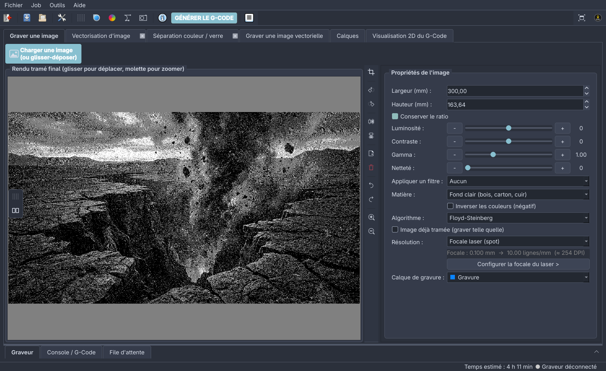

Éditeur vectoriel : dessiner, importer un SVG ou un DXF, ou partir d’un générateur :


Séparation couleur / verre (calque noir à graver, calque couleur à imprimer, simulation) :


Visualisation 2D du G-Code, avec la position du job sur le plateau et ses statistiques :

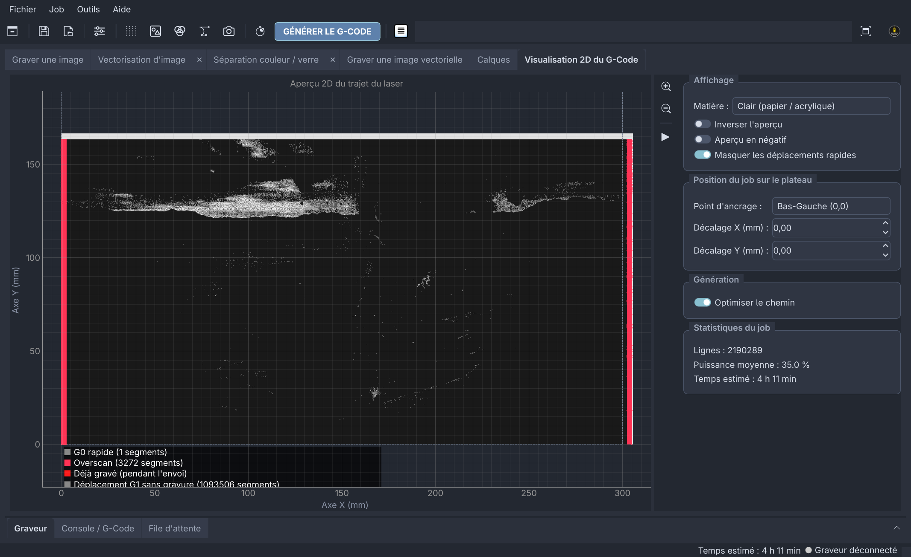

Interface en anglais et en allemand (aussi en espagnol) :

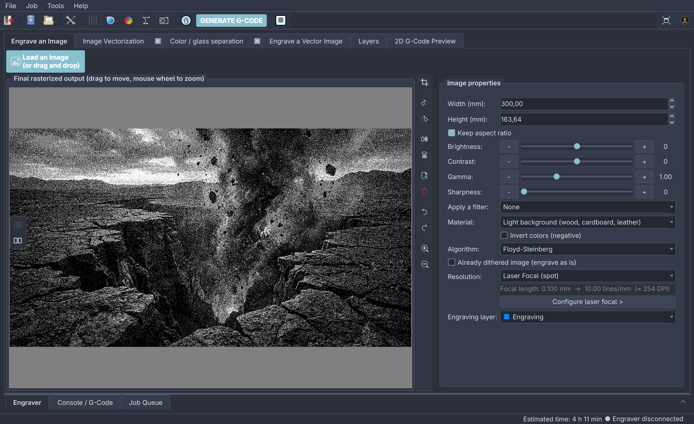

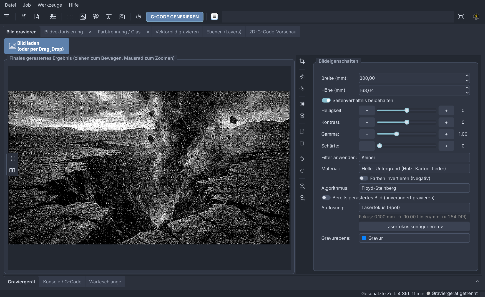

Toutes les captures, onglet par onglet, sont à la fin de ce document ([Captures de chaque onglet et page](#captures-de-chaque-onglet-et-page)).

## Nouveautés de la version 3.0.0

Une nouvelle version majeure : presque tout a changé.

- **Refonte de l'interface** : onglets et panneau du bas inspirés de VS Code, éditeur vectoriel épuré, menu Job avec raccourcis clavier, une seule fenêtre de confirmation avant de graver.
- **Refonte du style** : nouveau thème « New Dusk », libellés harmonisés dans les quatre langues.
- **Refonte du code** : modèle MVC (modèle / vue / contrôleur), code métier séparé du code graphique, plus de 1 500 tests.
- **Nouveaux générateurs et outils** : porte-clés, boule de Noël, boîte, puzzle, bibliothèque de modèles, macros, historique des gravures, alignement par caméra, axe rotatif (gobelets, bouteilles, stylos).
- **Gravure plus sûre** : arrêt d'urgence toujours visible, cadrage au plus près, reprise d'un travail interrompu.

Le détail est dans le [CHANGELOG](CHANGELOG.md).

## Nouveautés de la version 2.5.0

- **Stencil Studio** : un nouvel espace de travail pour créer et optimiser des pochoirs et des designs vectoriels ou matriciels, accessible par un bouton de la barre de menus :
  - **trame par point et par ligne** : les images deviennent des motifs de points ou de lignes prêts à graver ;
  - **effet Low Poly** : les images deviennent des compositions de polygones ;
  - **générateur de boîte avec éclairage** : boîtier sur mesure avec logements pour les LED et l'alimentation, assemblé par encoches ;
  - export direct vers Laser Studio Pro.
- **Barre de menus réorganisée** pour accéder rapidement aux différents studios et aux réglages.

Précédemment, dans la version 2.4.0 :

- **Imbrication automatique** : range les pièces sur une feuille pour gaspiller le moins de matière possible (rotations, écart, marge, emboîtement dans les creux ; les trous et détails suivent leur pièce).
- **Ordre de découpe sûr** : graver avant de découper, et couper l’intérieur avant l’extérieur, pour qu’une pièce ne bouge pas avant que ses détails soient faits.
- **Netteté** dans les réglages photo : accentue les contours avant le tramage.
- **Menus de réglages** (Paramètres Machine, Machine & Profils, Configuration GRBL, Matrice de test), **image insérée à sa taille d’origine**, **flèches du clavier** dans l’éditeur vectoriel et homing automatique activé par défaut.
- **Remplissage vectoriel corrigé** : plus de vides aux croisements de traits, et le décalage aller/retour s’applique aussi aux remplissages (contours moins en escalier).

Précédemment, dans la version 2.3.0 :

- **Import DXF** dans l’éditeur vectoriel (lignes, polylignes, cercles, arcs, ellipses, splines, blocs), avec réunion automatique des segments en contours.
- **Générateur de boîte à encoches** : panneaux prêts à découper, avec décor texte ou SVG gravé sur les faces.
- **Décalage aller/retour** : corrige le flou des contours verticaux de la gravure d’image, avec un motif de test pour trouver la bonne valeur (mémorisée par machine).
- **Assistant de calibrage du gain de point** pour la gravure sur verre : une grille à graver pour régler le curseur au bon endroit.
- **Fin de job fiable** : l’application attend que la machine soit réellement à l’arrêt (état Idle), et un Reset n’est plus annoncé comme une fin normale.
- **Sauvegardes en arrière-plan** : l’autosave et la file d’attente ne figent plus l’interface.
- **Boîtes de dialogue de l’éditeur vectoriel traduites**, et tutoiement harmonisé dans toutes les langues.

Précédemment, dans la version 2.2.0 :

- **Sélecteur « Matière »** (Image / Filtres) : fond noir ou fond clair, qui coche ou décoche « Inverser les couleurs » ; la matière est rappelée dans l’alerte avant gravure et enregistrée dans le projet.
- **Réglages des calques mémorisés par machine** : vitesse, puissance, passes… retrouvés à la réouverture, propres à chaque profil machine.
- **Séparation couleur / verre** : calque noir, calque couleur, simulation et PDF d’impression à l’échelle 1:1.
- **Correction importante de la gravure d’image** : le G-Code appliquait la puissance au mauvais segment ; régénérez les G-Codes d’image créés avec une version antérieure.
- **Reset / arrêt d’urgence** : le statut « référencé » est retiré si la machine n’était pas à l’arrêt, un nouveau homing est demandé.
- **Sauvegardes atomiques** (autosave, file d’attente, projet) : plus de fichier tronqué en cas de plantage.

Voir [`CHANGELOG.md`](CHANGELOG.md) pour le détail et les versions précédentes.

## Pour les développeurs

- [CONTRIBUTING.md](CONTRIBUTING.md) : structure du projet, compilation, tests, simulation d’un graveur et journal de débogage ;
- [ARCHITECTURE.md](ARCHITECTURE.md) : rôle de chaque dossier et de chaque fichier, glossaire des objets du code ;
- [BUILD.md](BUILD.md) : compilation pour Windows, Linux et macOS ;
- [CODE_SIGNING.md](CODE_SIGNING.md) : politique de signature du binaire Windows (*code signing policy*) ;
- [CHANGELOG.md](CHANGELOG.md) : historique détaillé des versions.

## Remerciements

Merci à toutes les personnes qui contribuent au projet, testent les fonctionnalités et signalent les bugs.

## Captures de chaque onglet et page

Images produites par `tools/screenshots.py` (thème Sombre, avec une image d’exemple chargée et son G-Code généré).

### Onglets

**Graver une image :**


**Vectorisation d’image :**


**Séparation couleur / verre :**


**Graver une image vectorielle :**


**Calques :**

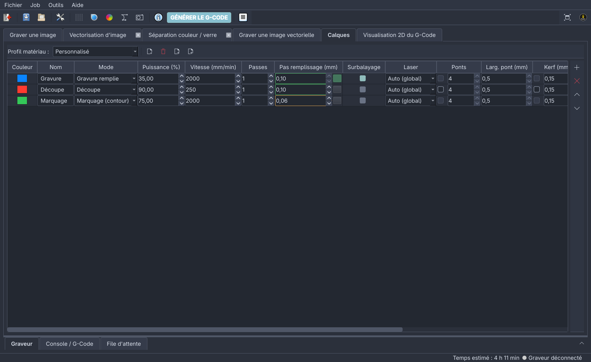

**Visualisation 2D du G-Code :**


### Fenêtre Paramètres (Fichier › Paramètres…)

**Paramètres du graveur :**


**Configuration GRBL :**

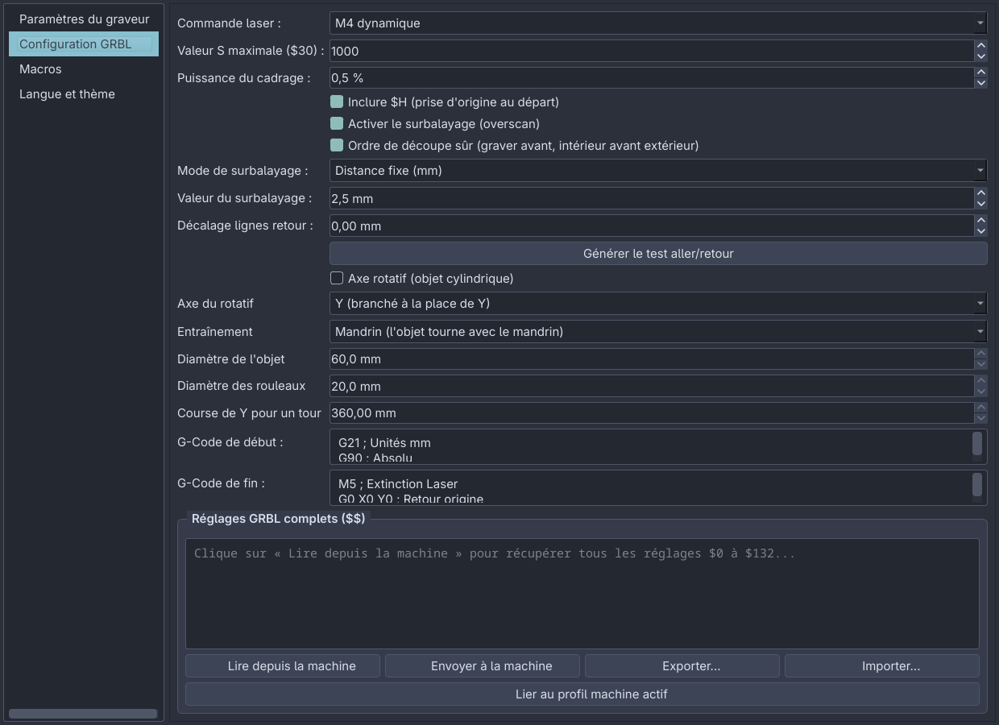

**Macros :**

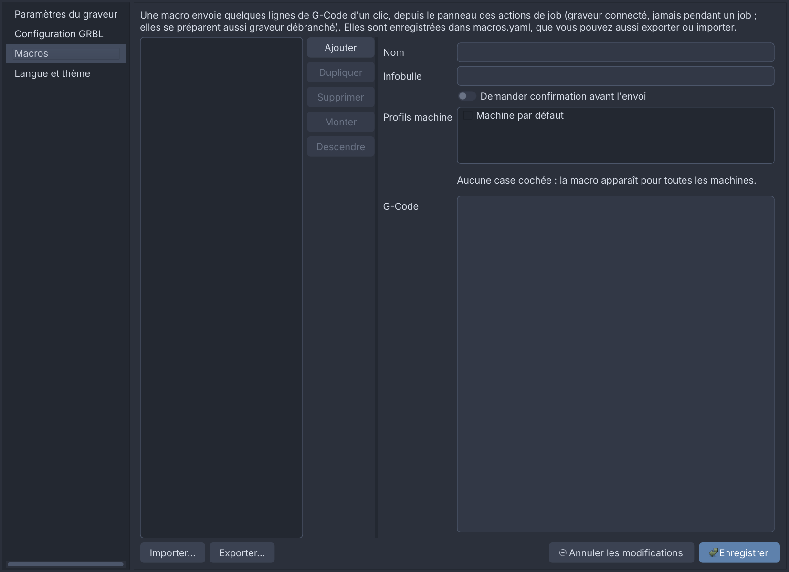

**Langue et thème :**

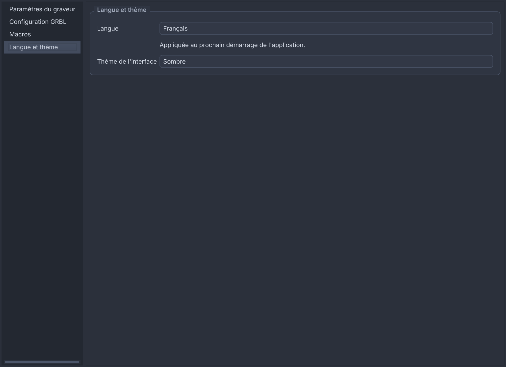

**Matrice de test (Outils) :**

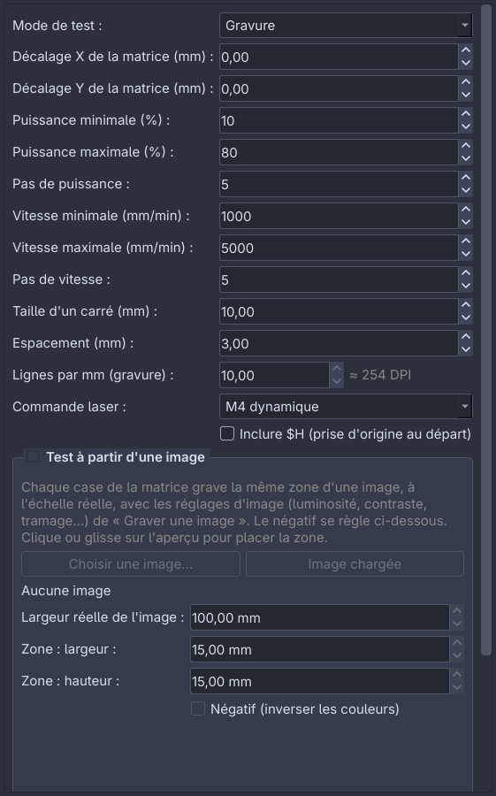

### Fenêtres

**Premiers pas (au premier démarrage, et Aide › Premiers pas) :**

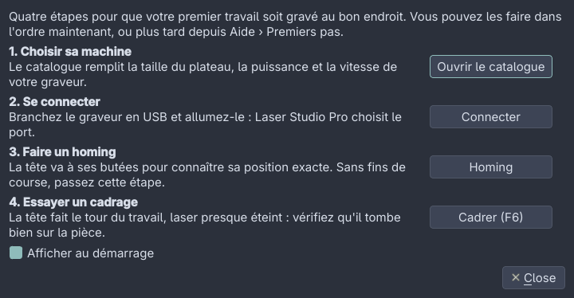

**Générateur de boîte à encoches :**

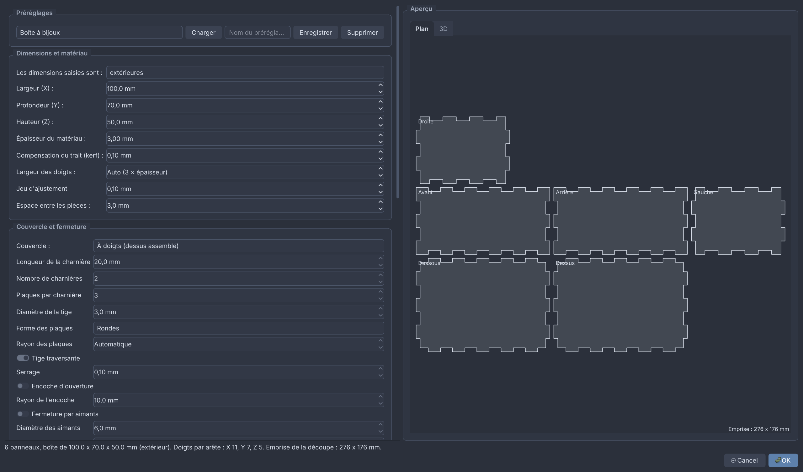

**Imbrication automatique :**

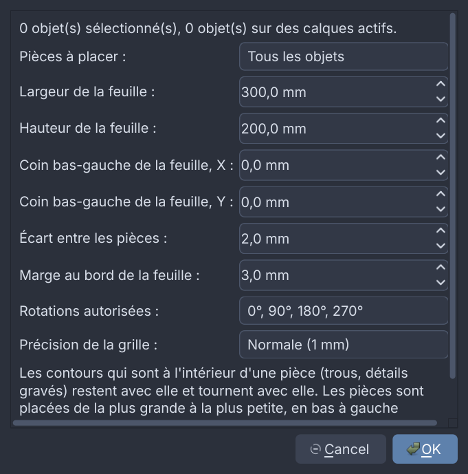
