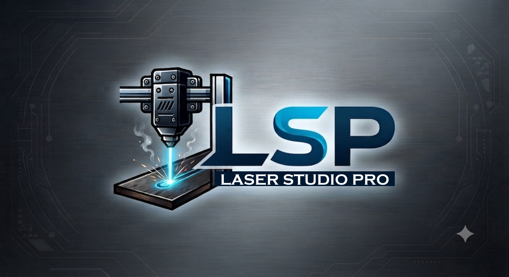

# Laser Studio Pro — Guide de démarrage

Vous n'avez jamais gravé ? Ce guide vous accompagne pas à pas : régler votre graveur une fois pour toutes, comprendre les calques et les matériaux, puis réaliser vos premières pièces à travers des exemples concrets.

Chaque chapitre « Comment… » se suit de bout en bout, dans l'ordre. Gardez le logiciel ouvert à côté et faites les étapes en même temps.

**Au sommaire**

1. [La sécurité avant tout](#1-la-sécurité-avant-tout)
2. [Premier démarrage](#2-premier-démarrage)
3. [Régler son graveur, une fois pour toutes](#3-régler-son-graveur-une-fois-pour-toutes)
4. [Comprendre les calques et les matériaux](#4-comprendre-les-calques-et-les-matériaux)
5. [Comment trouver les bons réglages pour une matière](#5-comment-trouver-les-bons-réglages-pour-une-matière)
6. [Comment graver une photo](#6-comment-graver-une-photo)
7. [Comment créer une médaille, de la bibliothèque à la gravure](#7-comment-créer-une-médaille-de-la-bibliothèque-à-la-gravure)
8. [Comment faire un porte-clés avec un prénom](#8-comment-faire-un-porte-clés-avec-un-prénom)
9. [Pendant la gravure (pause, arrêt, reprise)](#9-pendant-la-gravure-pause-arrêt-reprise)
10. [Ça ne marche pas, que faire](#10-ça-ne-marche-pas-que-faire)
11. [Raccourcis clavier](#11-raccourcis-clavier)

---

## 1. La sécurité avant tout

Un graveur laser est une **machine dangereuse**. Le faisceau brûle la matière : c'est ce qui grave, mais c'est aussi ce qui peut déclencher un feu ou blesser les yeux en une fraction de seconde. Ces règles ne sont pas des précautions de principe : chacune évite un accident réel.

**À chaque gravure**

- **Ne quittez jamais la machine des yeux.** Une flamme peut apparaître en quelques secondes, surtout en découpe. Restez à côté du début à la fin.
- **Portez des lunettes de protection** prévues pour la longueur d'onde de votre laser (indiquée par le constructeur, souvent 445 à 455 nm pour une diode bleue). Des lunettes de soleil ne protègent pas. Faites-en porter aux personnes présentes.
- **Aérez ou aspirez les fumées.** La gravure dégage des fumées et des particules : travaillez dans une pièce ventilée, idéalement avec une extraction vers l'extérieur.
- **Gardez un extincteur à portée de main** (CO₂ ou poudre) et ne laissez rien d'inflammable autour de la machine.
- **Connaissez l'arrêt d'urgence** : la touche **F9**, ou le bouton rouge **Arrêt d'urgence** qui apparaît dans la barre d'outils pendant une gravure. Le laser s'éteint aussitôt.

**Les matières à ne jamais graver**

| Matière | Pourquoi |
|---|---|
| PVC, vinyle, simili-cuir en PVC | Dégage du chlore : gaz toxique et corrosif, qui abîme aussi la machine |
| Polycarbonate (Lexan) | Brûle mal, jaunit, dégage des fumées nocives |
| ABS | Fond et dégage des fumées toxiques |
| Fibre de verre, fibre de carbone | Poussières et fumées dangereuses |
| Tout ce dont vous ignorez la composition | Dans le doute, abstenez-vous |

> **Le logiciel vous le rappelle.** Au démarrage, puis avant chaque gravure, une fenêtre de sécurité demande confirmation. Prenez le temps de la lire : elle liste aussi ce qui pose problème dans le travail à envoyer.

---

## 2. Premier démarrage

Au premier lancement, après l'avertissement de sécurité, la fenêtre **Premiers pas** s'ouvre. Elle propose les quatre étapes qui font que votre premier travail sera gravé au bon endroit :

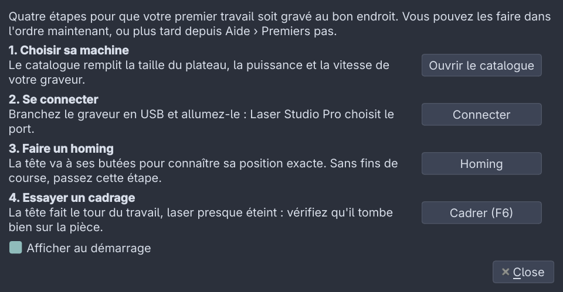

1. **Choisir sa machine** : le logiciel connaît la taille de votre plateau et votre laser.
2. **Se connecter** au graveur.
3. **Faire un homing** : la tête apprend sa position exacte.
4. **Essayer un cadrage** : la tête fait le tour du travail, laser presque éteint, pour vérifier l'emplacement.

Chaque étape se coche (« ✓ Fait ») quand elle est réussie. Vous pouvez les faire maintenant ; le chapitre suivant les détaille. La fenêtre revient à chaque démarrage tant que **Afficher au démarrage** reste coché, et s'ouvre aussi par le menu **Aide › Premiers pas**.

---

## 3. Régler son graveur, une fois pour toutes

Ces réglages se font **une seule fois** par machine. Ensuite, vous n'y touchez plus.

### 3.1 Choisir sa machine dans le catalogue

Dans **Premiers pas**, cliquez sur **Ouvrir le catalogue** (ou **Fichier › Paramètres… › Paramètres du graveur › Depuis le catalogue…**).

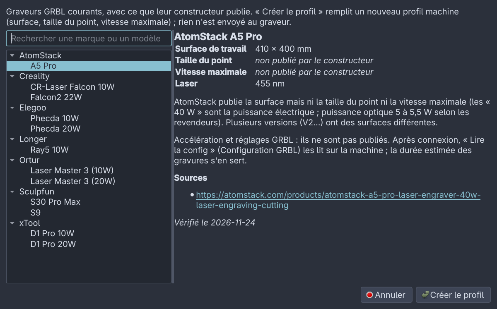

1. Trouvez votre marque et votre modèle (la recherche en haut aide).
2. Vérifiez la surface de travail affichée à droite.
3. Cliquez sur **Créer le profil**.

Votre graveur n'est pas dans la liste ? Pas de problème : dans **Paramètres du graveur**, cliquez sur **+ Nouvelle machine** et saisissez vous-même la **largeur** et la **profondeur** de la zone de travail (dans la documentation du constructeur) et la **taille du spot**.

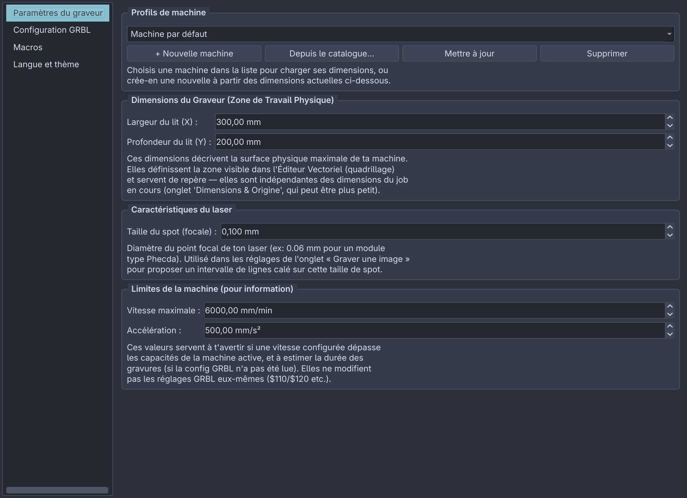

> **La taille du spot** est le diamètre du point de lumière du laser une fois bien mis au point (souvent 0,08 à 0,1 mm pour une diode). Laser Studio Pro s'en sert pour proposer le bon nombre de lignes par millimètre en gravure.

### 3.2 Se connecter au graveur

1. **Allumez le graveur** et branchez-le à l'ordinateur en **USB**.
2. Dans **Premiers pas**, cliquez sur **Connecter**. Le panneau **Graveur**, en bas de la fenêtre, s'ouvre ; vous pouvez aussi y choisir le port et cliquer sur **Connecter**.
3. Quand la connexion réussit, l'état du graveur s'affiche : **Prêt**. Il est aussi écrit en bas à droite de la fenêtre, avec la position de la tête.

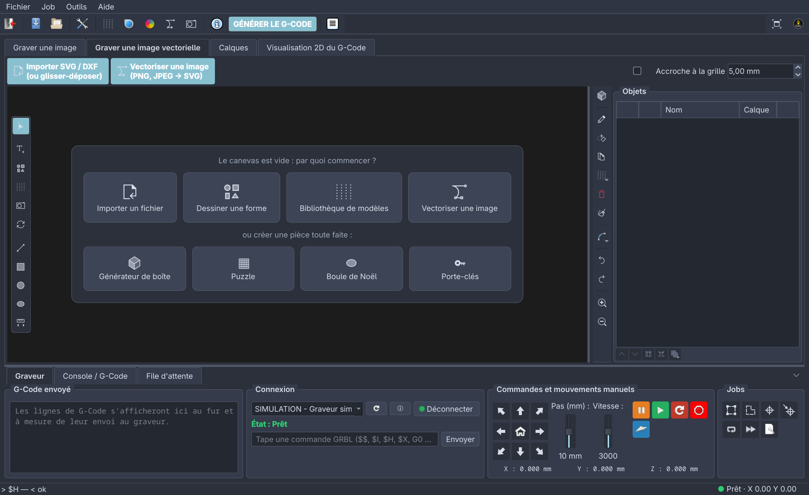

**Le port n'apparaît pas ?**

- Sous **Windows**, il peut manquer le pilote USB de la carte du graveur (souvent un pilote « CH340 » ou « CP210x », fourni par le constructeur). Le bouton **Port introuvable ?** (à côté de la liste des ports) explique quoi installer.
- Sous **Linux**, votre utilisateur doit faire partie du groupe `dialout` : `sudo usermod -aG dialout $USER`, puis fermez et rouvrez votre session.
- Essayez un autre câble USB : certains câbles ne servent qu'à la charge et ne transmettent pas de données.

À la connexion, Laser Studio Pro lit la configuration du graveur et vous prévient si un réglage important pose problème (mode laser désactivé, homing absent…).

### 3.3 Faire un homing (ou s'en passer)

Le **homing** envoie la tête contre ses butées (les « fins de course ») pour qu'elle connaisse sa position exacte. C'est ce qui garantit qu'une pièce placée au coin du plateau sera gravée au coin du plateau.

- Votre graveur a des fins de course : cliquez sur **Homing** (dans Premiers pas, ou sur l'icône maison du panneau Graveur). La tête part vers son origine puis s'arrête. Faites-le **à chaque mise sous tension**.
- Votre graveur **n'a pas de fins de course** : le logiciel le détecte à la connexion et l'annonce (« homing non supporté »). Il n'envoie alors plus jamais la commande de homing. Placez simplement la tête à la main au coin avant gauche avant d'allumer le graveur : ce sera l'origine.

### 3.4 La configuration GRBL

Votre graveur fonctionne avec **GRBL**, un petit programme qui reçoit les ordres de déplacement. Ses réglages se trouvent dans **Fichier › Paramètres… › Configuration GRBL**.

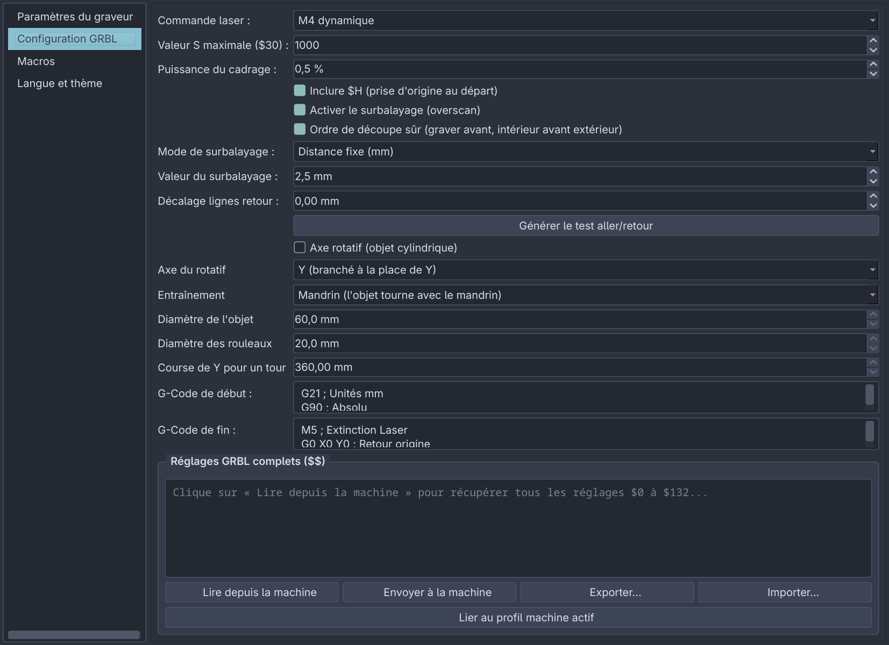

Pour commencer, une seule chose à faire : cliquez sur **Lire la config** (graveur connecté). Le logiciel récupère les vrais réglages de la machine, dont sa **valeur S maximale** (le réglage `$30`, souvent 1000), qui sert à calculer les pourcentages de puissance.

Laissez les autres réglages par défaut tant que tout fonctionne :

- **Commande laser M4** (puissance dynamique) : la puissance s'adapte à la vitesse réelle, les coins ne sont pas brûlés. C'est le bon choix pour une diode.
- **Ordre de découpe sûr** : coché. Le logiciel grave avant de découper, et découpe l'intérieur d'une pièce avant son contour, pour que rien ne bouge en cours de route.

### 3.5 La mise au point (focale)

Le laser doit être à la **bonne hauteur** au-dessus de la matière : c'est ce qui donne un point fin et une gravure nette. Chaque graveur a sa méthode (cale fournie, molette, distance indiquée dans la notice) : suivez celle du constructeur, et **refaites-la à chaque changement d'épaisseur de matière**. Une gravure floue ou large vient presque toujours d'une mise au point oubliée.

### 3.6 Le cadrage : vérifier l'emplacement avant de graver

Avant chaque gravure, **cadrez** : la tête fait le tour du travail avec le laser à peine allumé (0,5 % de la puissance), juste assez pour voir le point lumineux sans marquer la matière.

- **F6** : le rectangle qui contient tout le travail.
- **Maj+F6** : le tour au plus près de chaque pièce, utile pour une forme ronde ou découpée.

Si la pièce dépasse de la matière, décalez la matière (ou le travail) et recadrez. Le point lumineux n'apparaît pas ? Augmentez **Puissance du cadrage** dans la Configuration GRBL (1 ou 2 % suffisent sur certaines diodes).

---

## 4. Comprendre les calques et les matériaux

Deux notions travaillent ensemble, dans l'onglet **Calques** :

- les **calques** disent **quoi faire** : graver, découper ou marquer ;
- le **matériau** dit **avec quelle force** : on ne découpe pas du contreplaqué de 3 mm comme du cuir.

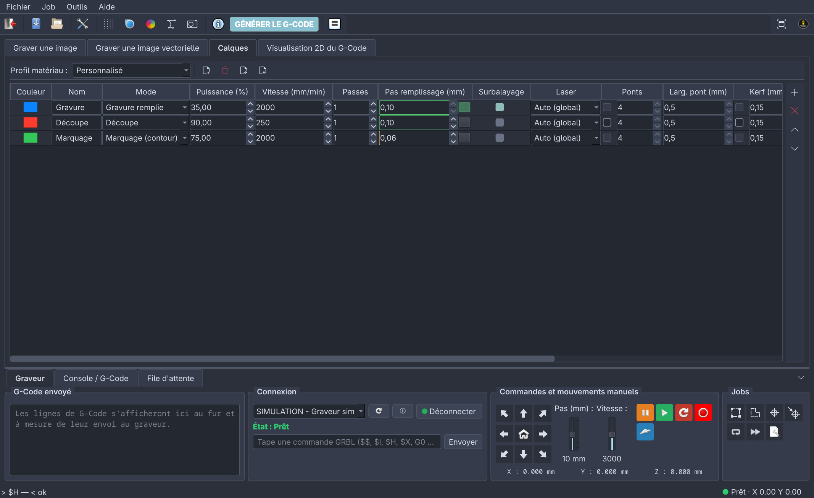

**Les trois calques de base**

| Calque | Couleur | Ce que fait le laser |
|---|---|---|
| **Gravure** | bleu | Remplit les surfaces, ligne par ligne (photos, textes pleins, logos) |
| **Découpe** | rouge | Suit les contours à forte puissance et faible vitesse, pour traverser la matière |
| **Marquage** | vert | Suit les contours à faible puissance : un trait fin, sans creuser |

Chaque élément de votre travail est rangé sur un calque, et sa couleur à l'écran vous dit ce que le laser en fera. Les calques sont exécutés de haut en bas : la gravure d'abord, la découpe à la fin.

**Les réglages d'un calque**

- **Puissance (%)** : la force du laser. Plus elle est haute, plus la marque est sombre et profonde.
- **Vitesse (mm/min)** : la vitesse de la tête. Plus elle est lente, plus le laser reste longtemps au même endroit, donc plus il brûle.
- **Passes** : combien de fois le laser repasse. Pour découper une matière épaisse, deux passes moyennes valent souvent mieux qu'une seule très lente.

**Le matériau**

En haut de l'onglet, la liste **Profil matériau** propose des matières de départ : contreplaqué 3 mm, MDF 4 mm, acrylique 3 mm, ardoise, cuir 2 mm… Choisir un matériau change d'un coup la puissance, la vitesse et les passes de tous les calques ; votre dessin, lui, ne change pas. Ces valeurs sont des **points de départ** : chaque laser est différent, le chapitre suivant explique comment trouver les vôtres.

Créez vos propres matériaux avec **Nouveau profil…** (« Bambou 4 mm », « Cuir de mon fournisseur »…) : vos réglages y sont enregistrés automatiquement, machine par machine.

---

## 5. Comment trouver les bons réglages pour une matière

**Exemple : vous voulez graver sur des planchettes de bouleau, et vous ne savez pas quelle puissance choisir.**

La méthode sûre, c'est la **matrice de test** : le logiciel grave une grille de petits carrés, chacun avec une puissance et une vitesse différentes. Vous regardez le résultat et vous choisissez.

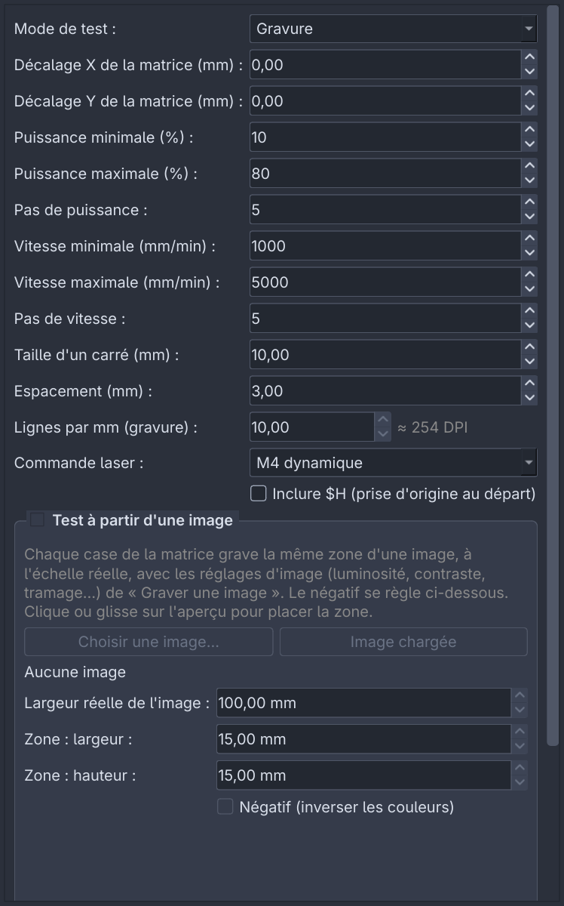

1. Ouvrez **Outils › Matrice de test**.
2. Choisissez une **plage de puissances** (par exemple de 10 à 60 %) et une **plage de vitesses** (par exemple de 1 000 à 4 000 mm/min). Les carrés sont étiquetés avec leurs valeurs.
3. Posez une **chute de la même matière** sur le plateau, faites la mise au point (§ 3.5) et cadrez (F6).
4. Lancez la gravure de la matrice et **restez à côté**.
5. Regardez le résultat :
   - pour une **gravure**, choisissez le carré le plus beau : sombre sans être brûlé, avec des bords nets ;
   - pour une **découpe**, cherchez la vitesse la plus rapide qui traverse proprement (retournez la chute pour vérifier) ;
   - pour un **marquage**, la puissance la plus faible qui laisse un trait bien visible.
6. Reportez la puissance et la vitesse de ce carré dans le calque correspondant (onglet **Calques**), dans votre matériau.

> **Astuce** : la matrice peut aussi graver un morceau de votre propre image dans chaque carré. C'est le meilleur moyen de choisir les réglages d'une photo.

---

## 6. Comment graver une photo

**Exemple : « Je n'ai jamais gravé, je veux graver la photo de mon chien sur une planchette en bois de 10 × 10 cm. »**

### Étape 1 — Choisir une bonne photo

Une photo **bien contrastée**, avec un sujet net et un fond simple, donne les meilleurs résultats. Évitez les photos sombres ou floues : la gravure ne rattrape pas une mauvaise photo.

### Étape 2 — Charger la photo

1. Ouvrez l'onglet **Graver une image**.
2. Cliquez sur **Charger une image** (ou glissez le fichier dans la fenêtre). Les formats PNG, JPEG et BMP sont acceptés.

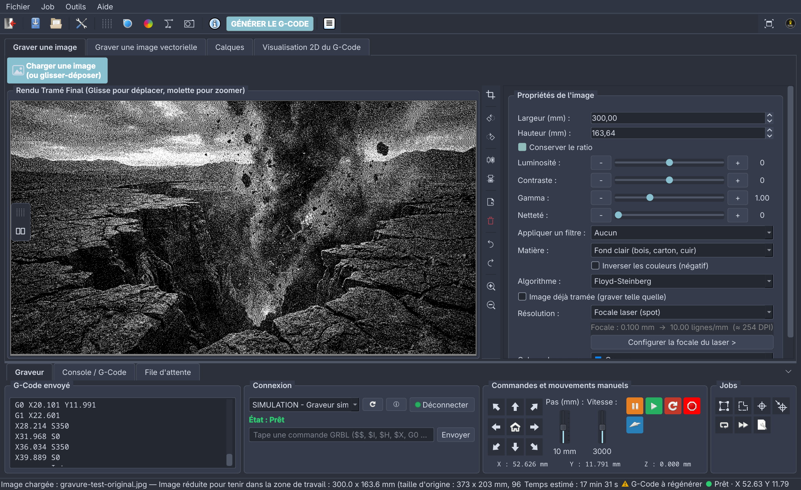

### Étape 3 — Donner la taille

Dans les **propriétés de l'image**, à droite, saisissez la **largeur** voulue en millimètres (ici 100). Laissez **Conserver le ratio** coché : la hauteur suit, la photo n'est pas déformée.

> **Commencez petit.** Une photo de 30 cm demande plusieurs heures ; une de 10 cm, une demi-heure environ. Le temps estimé s'affiche en bas à droite de la fenêtre dès que le G-Code est généré.

### Étape 4 — Choisir la matière

Dans **Matière**, choisissez :

- **Fond clair** pour le bois, le carton, le cuir : le laser noircit ce qu'il brûle ;
- **Fond noir** pour l'aluminium anodisé, l'ardoise, le verre peint : le laser éclaircit, et le logiciel inverse la photo pour que le résultat lui ressemble.

### Étape 5 — Régler l'image

Ajustez **Luminosité**, **Contraste** et **Gamma** en regardant l'aperçu à gauche ; un peu de **Netteté** (20 à 40) fait ressortir les détails, les yeux d'un portrait par exemple. Chaque réglage s'annule avec **Ctrl+Z**.

Sur du bois, un aperçu légèrement **plus clair** que ce que vous voulez est souvent juste : le bois fonce à la gravure.

### Étape 6 — Choisir le tramage

Un laser ne fait pas de gris : à chaque point, il grave ou non. Le **tramage** imite les nuances par la densité des points, comme une photo dans un journal.

- **Floyd-Steinberg** : le bon choix pour une première photo.
- **Jarvis** ou **Stucki** : un grain plus fin, très bien pour les portraits.
- **Seuil simple** : noir ou blanc, sans nuance, pour un logo ou un texte.

Vous hésitez ? Le bouton **Algorithme de tramage**, en haut de la barre à gauche de l'aperçu, montre votre photo avec chaque tramage : cliquez sur celle qui vous plaît.

### Étape 7 — Vérifier le calque

La photo est gravée avec les réglages du calque **Gravure** (liste **Calque de gravure**). Vérifiez dans l'onglet **Calques** que le bon **matériau** est choisi, et la puissance trouvée au chapitre 5.

### Étape 8 — Générer et vérifier

Appuyez sur **F5** (ou **Générer le G-Code**), puis ouvrez **Visualisation 2D du G-Code** : vous voyez ce que le laser va faire, la position sur le plateau, le nombre de lignes et le **temps estimé**.

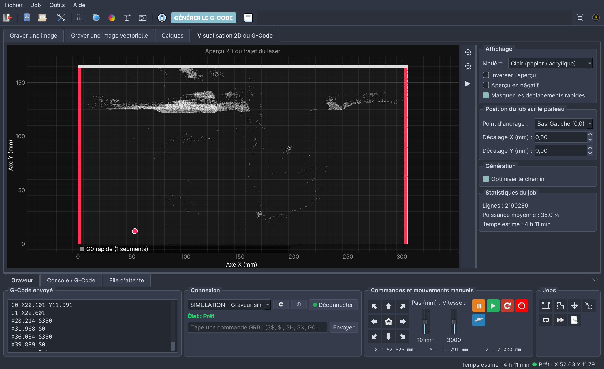

Le bouton **Simuler** (▶, à droite de l'aperçu) rejoue le parcours du laser en une quinzaine de secondes.

### Étape 9 — Placer, cadrer, graver

1. Posez la planchette sur le plateau, faites la **mise au point** (§ 3.5).
2. **Cadrez** (F6) : la tête fait le tour de la photo. Ajustez la planchette si besoin, recadrez.
3. Mettez vos **lunettes**, lancez l'aspiration.
4. Appuyez sur **Ctrl+Entrée** (ou **Envoyer au laser**). Une seule fenêtre récapitule la sécurité et ce qui pose éventuellement problème ; lisez-la, puis confirmez.

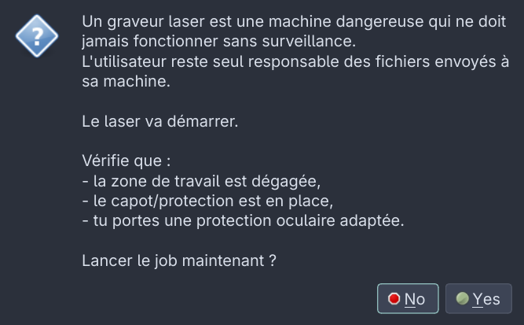

5. **Restez à côté** pendant toute la gravure. Le tracé rouge, dans la Visualisation 2D, montre ce qui est déjà gravé.

Une fois la gravure finie, attendez quelques secondes que la fumée retombe avant d'ouvrir le capot ; nettoyez la surface avec un chiffon légèrement humide pour enlever la suie.

---

## 7. Comment créer une médaille, de la bibliothèque à la gravure

**Exemple : votre club organise la « Régate de printemps 2026 », il vous faut des médailles en contreplaqué de 3 mm, avec le nom de la compétition, gravées puis découpées.**

### Étape 1 — Ouvrir la bibliothèque

Dans l'onglet **Graver une image vectorielle**, cliquez sur **Bibliothèque de modèles** (sur le canevas vide, ou dans la barre à gauche du canevas). Vous pouvez aussi passer par **Outils › Bibliothèque…**.

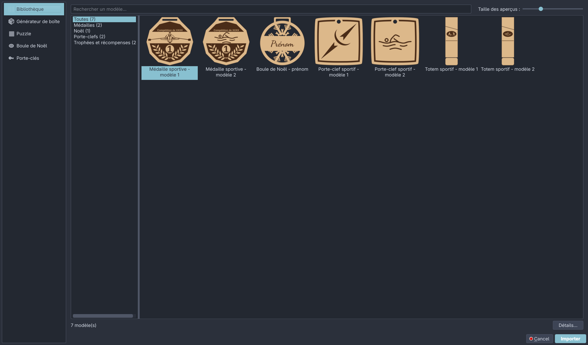

### Étape 2 — Choisir et personnaliser le modèle

Double-cliquez sur **Médaille sportive — modèle 1**. Sa fiche s'ouvre :

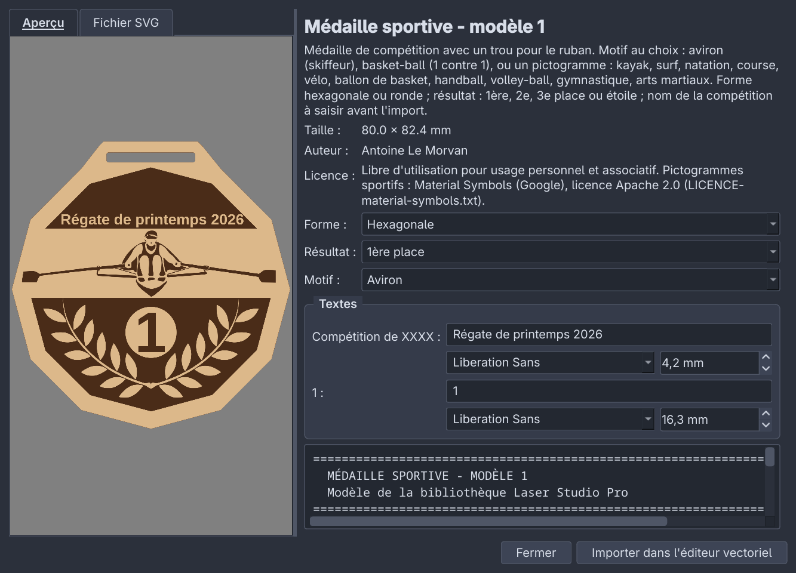

1. Choisissez la **forme** (hexagonale ou ronde), le **résultat** (1re, 2e, 3e place ou étoile) et le **motif** (aviron, natation, course, vélo…).
2. Dans **Textes**, remplacez « Compétition de XXXX » par le nom de votre compétition. Changez la police ou la taille si le texte déborde : l'aperçu se met à jour.
3. Cliquez sur **Importer dans l'éditeur vectoriel**.

### Étape 3 — Vérifier la médaille dans l'éditeur

La médaille arrive sur la grille, à sa taille réelle (8 cm environ). Les parties à **graver** sont en bleu, le **contour à découper** et le trou du ruban en rouge.

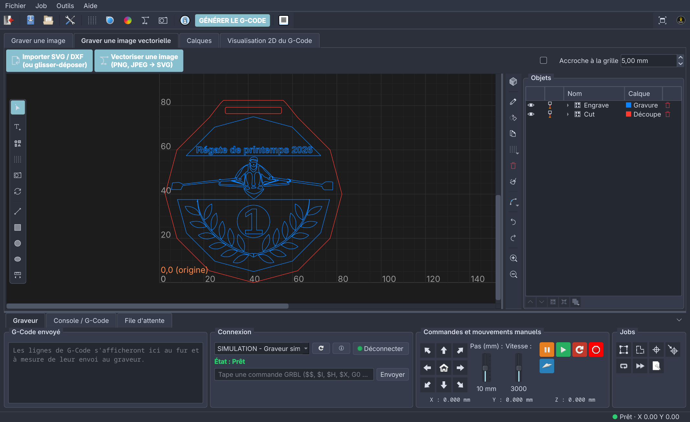

- Pour la déplacer, faites-la glisser ; pour la redimensionner, utilisez **Largeur** et **Hauteur** dans les propriétés, à droite.
- Il vous en faut dix ? Sélectionnez-la, puis **Disposer › Dupliquer en série** : les exemplaires sont rangés sur la plaque. Pour faire tenir le maximum de pièces sur une plaque, **Disposer › Imbrication auto**.

### Étape 4 — Choisir le matériau

Dans l'onglet **Calques**, choisissez le **profil matériau** de votre plaque (ici *Contreplaqué 3mm*), avec les réglages vérifiés grâce à la matrice de test (chapitre 5) : le calque **Gravure** pour le décor, le calque **Découpe** pour traverser les 3 mm.

### Étape 5 — Générer et vérifier

Appuyez sur **F5**, puis ouvrez **Visualisation 2D du G-Code**. Vérifiez la position de la médaille sur le plateau et le temps estimé.

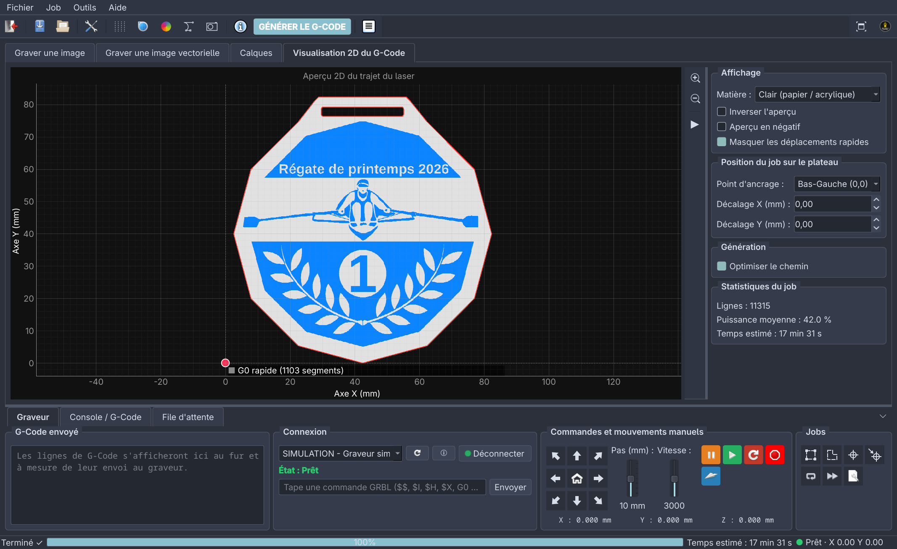

### Étape 6 — Graver puis découper

1. Posez la plaque, faites la **mise au point**, **cadrez** avec **Maj+F6** : la tête fait le tour exact de la médaille.
2. Lunettes, aspiration, **Ctrl+Entrée**, lisez la fenêtre de sécurité, confirmez.
3. Le laser grave d'abord le décor, puis découpe le trou du ruban et enfin le contour : la pièce ne se détache qu'à la toute fin, sans bouger pendant la gravure.

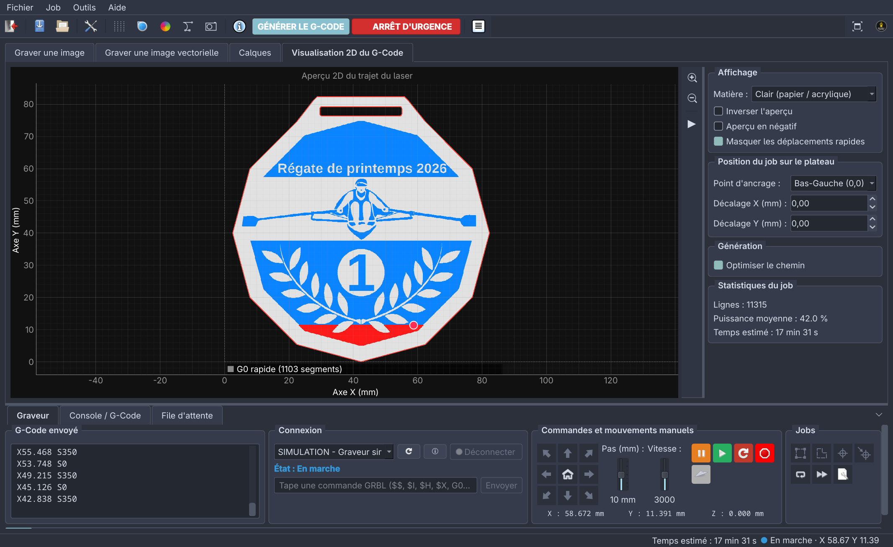

4. **Surveillez la découpe de près** : c'est le moment où une flamme peut apparaître. Si c'est le cas, appuyez sur **F9**.
5. À la fin, laissez refroidir quelques secondes, puis sortez la médaille. Si elle tient encore par endroits, ne forcez pas : la découpe manquait de puissance. Ajoutez une passe au calque **Découpe** pour la prochaine fois.

> **Une matière chère ?** Passez d'abord le contour sur le calque **Marquage** et gravez : le laser trace un trait léger au lieu de traverser. Vous vérifiez la position sans rien gâcher.

---

## 8. Comment faire un porte-clés avec un prénom

**Exemple : un porte-clés en bois au prénom « Emma », pour un cadeau.**

1. Dans l'onglet **Graver une image vectorielle**, cliquez sur **Porte-clés** (sur le canevas vide), ou sur l'icône **Générateurs** en tête de la barre à droite du canevas, puis **Porte-clés**.

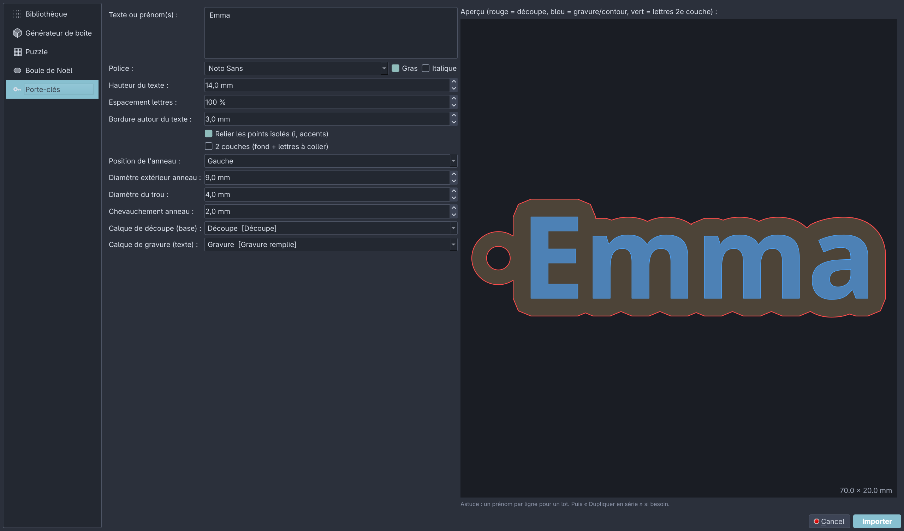

2. Tapez le prénom, choisissez une **police** (une police manuscrite donne des lettres reliées) et la **hauteur du texte**.
3. Choisissez la **position de l'anneau** et son diamètre.
4. Cliquez sur **Importer** : le prénom est sur le calque **Gravure**, le contour et l'anneau sur le calque **Découpe**.
5. Plusieurs prénoms ? Tapez-en un par ligne : chaque prénom devient un porte-clés.
6. Choisissez le matériau, puis **F5**, **Maj+F6** pour cadrer, et **Ctrl+Entrée** pour graver, comme pour la médaille.

> Le menu **Outils** propose d'autres générateurs sur le même principe : boîte à encoches à assembler, puzzle découpé à partir d'une photo, boule de Noël avec prénom.

---

## 9. Pendant la gravure (pause, arrêt, reprise)

| Je veux… | Je fais… |
|---|---|
| Mettre en pause (remettre la matière en place, vérifier) | **F7**, puis **F8** pour reprendre |
| Arrêter tout de suite (flamme, erreur, mauvaise position) | **F9**, ou le bouton rouge **Arrêt d'urgence** de la barre d'outils |
| Reprendre un travail interrompu (arrêt d'urgence, coupure, erreur) | **F8**, ou **Reprendre le job** dans le cadre *Jobs* du panneau Graveur |

**Reprendre après un arrêt.** Après un arrêt d'urgence, le graveur se met en **alarme** : par sécurité, il ne connaît plus sa position. Faites un **homing** (ou cliquez sur **Déverrouiller** si votre graveur n'a pas de fins de course), puis **F8** : la tête revient, laser éteint, au point exact de l'arrêt, et le travail continue sans double passage. Ne déplacez pas la pièce entre-temps.

---

## 10. Ça ne marche pas, que faire

**Le port du graveur n'apparaît pas dans la liste.**
Voir le § 3.2 : pilote USB sous Windows, groupe `dialout` sous Linux, câble USB de données.

**La gravure s'arrête juste après le début, avec un message d'erreur.**
Regardez l'onglet **Console / G-Code** du panneau du bas : la réponse du graveur y est écrite (`error:…` ou `ALARM:…`). Une alarme après un déplacement signale souvent un travail qui sort de la zone de travail : vérifiez la taille du plateau dans les Paramètres du graveur et la position du travail dans la Visualisation 2D.

**Le graveur est en « Alarme ».**
Faites un homing, ou cliquez sur **Déverrouiller** dans le panneau Graveur. Une alarme signale parfois un vrai problème (fin de course touchée, choc) : regardez la machine avant de déverrouiller.

**La gravure est décalée sur la matière.**
Faites un homing après chaque mise sous tension, et cadrez (F6) avant chaque gravure.

**La gravure est trop claire.**
Baissez la vitesse ou montez la puissance du calque, par petits pas. Vérifiez aussi la mise au point.

**La gravure est brûlée, noire, avec des bords flous.**
Montez la vitesse ou baissez la puissance. Une gravure large et floue vient souvent de la mise au point.

**La découpe ne traverse pas.**
Ajoutez une passe au calque **Découpe**, ou baissez sa vitesse. Vérifiez la mise au point : en découpe, elle compte encore plus.

**Un message parle de « G-Code à régénérer ».**
Vous avez changé un réglage après avoir généré le G-Code : appuyez sur **F5** pour le régénérer, sinon c'est l'ancienne version qui serait gravée.

**Il me faut plus de détails.**
L'aide complète s'ouvre avec la touche **F1** : chaque onglet et chaque outil y sont décrits.

---

## 11. Raccourcis clavier

| Touche | Action |
|---|---|
| **F1** | Aide |
| **F5** | Générer le G-Code |
| **F6** | Cadrer (rectangle autour du travail) |
| **Maj+F6** | Cadrer au plus près des pièces |
| **Ctrl+Entrée** | Envoyer au laser |
| **F7** | Pause |
| **F8** | Reprendre (après une pause ou un arrêt) |
| **F9** | Arrêt d'urgence |
| **Ctrl+Z / Ctrl+Y** | Annuler / refaire |
| **Ctrl+S / Ctrl+O** | Enregistrer / ouvrir un projet |
| **Ctrl+J** | Afficher ou masquer le panneau du bas |
| **F11** | Plein écran |

Survolez un bouton : son infobulle donne aussi son raccourci.

---

*Laser Studio Pro est un logiciel libre (GNU GPL v3), fait par des passionnés de gravure laser pour des passionnés de gravure laser.*
