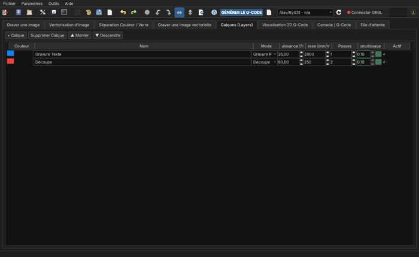

# Laser Studio Pro

Laser Studio Pro est plus qu'un logiciel de gravure : c'est un véritable
**studio de création**. Vous y préparez vos images, dessinez ou importez
vos formes, créez des objets prêts à découper (boîtes, puzzles, boules de
Noël, porte-clés…), puis vous pilotez votre graveur laser jusqu'à la pièce
terminée.

Cette aide s'ouvre à tout moment avec la touche **F1** ou par le menu
**Aide › Documentation**.

Au premier démarrage, la fenêtre **Premiers pas** propose quatre étapes :
choisir votre machine dans le catalogue, vous connecter, faire un homing et
essayer un cadrage. Chaque étape se coche quand elle est faite. Elle revient
tant que « Afficher au démarrage » reste coché, et s'ouvre aussi par
**Aide › Premiers pas**.

## ⚠ Avertissement de sécurité

> **Un graveur laser est une machine dangereuse qui ne doit jamais
> fonctionner sans surveillance.**
>
> - Restez à côté de la machine pendant toute la durée du travail : une
>   flamme peut apparaître en quelques secondes. Gardez un extincteur à
>   portée de main.
> - Portez des lunettes de protection adaptées à la longueur d'onde de
>   votre laser, et faites-les porter aux personnes présentes.
> - Aérez ou aspirez les fumées. Ne gravez jamais de PVC ni de vinyle :
>   ils dégagent des gaz toxiques et corrosifs.
> - Vérifiez le tracé dans l'onglet *Visualisation 2D du G-Code* avant de
>   lancer un travail.
>
> L'utilisateur reste seul responsable des fichiers envoyés à sa machine.

## Sommaire

- [Comment graver une image](graver-une-image.md)
- [Comment graver ou découper avec une image vectorielle](graver-decouper-vectoriel.md)
- [Images vectorielles](images-vectorielles.md) : qu'est-ce qu'un vecteur ?
- [Comprendre les calques et les matériaux](calques-et-materiaux.md)
- [Comprendre les différents modes de gravure](modes-de-gravure.md) : puissance fixe ou variable, surbalayage
- [Les outils](outils.md) : bibliothèque, générateurs, imbrication…

## Premiers pas

1. **Ouvrez une image** dans l'onglet *Graver une image*.
2. **Réglez** la taille, le contraste et le mode de tramage.
3. **Générez le G-code**, puis vérifiez-le dans l'onglet *Visualisation 2D du
   G-Code*.
4. **Connectez le graveur** et lancez le travail.

Les sections suivantes expliquent les notions utilisées par l'application.

## Les trois façons de travailler au laser

Tout travail au laser repose sur trois opérations.

**La gravure** : le laser balaie une surface, ligne après ligne, et noircit
ou creuse la matière. C'est ainsi que l'on reproduit une photo, un logo
plein ou un texte en aplat.

**La découpe** : le laser suit un contour, lentement et avec beaucoup de
puissance, en une ou plusieurs passes, jusqu'à traverser la matière. C'est
ce qui détache la pièce de la plaque.

**Le marquage** : le laser suit lui aussi un contour, mais avec peu de
puissance. Il laisse un trait fin à la surface, sans traverser : contour
décoratif, repère d'assemblage, ligne de pliage…

## Les calques

Dans Laser Studio Pro, ces trois opérations sont réalisées par des
**calques** (*layers*). Chaque élément de votre travail est rangé sur un
calque, et c'est le calque qui dit au laser comment le traiter.

Trois calques de base existent toujours : **Gravure**, **Découpe** et
**Marquage**. Ils ne peuvent pas être supprimés (on les désactive s'ils ne
servent pas). Vous pouvez en ajouter d'autres, par exemple deux gravures
plus ou moins foncées.

Chaque calque a ses réglages, dans l'onglet *Calques* :

| Réglage           | Rôle |
|-------------------|------|
| Mode              | *Gravure remplie*, *Découpe* ou *Marquage (contour)* |
| Puissance (%)     | Force du laser. Plus elle est élevée, plus la trace est profonde |
| Vitesse (mm/min)  | Vitesse de la tête. Plus elle est lente, plus le laser chauffe la matière |
| Passes            | Nombre de fois où le travail est répété, utile pour découper une matière épaisse |
| Pas remplissage   | Distance entre deux lignes de gravure (voir ci-dessous) |
| Surbalayage       | Gravure remplie : la tête dépasse un peu du dessin pour graver à vitesse constante |
| Laser             | Mode de puissance : *M3 fixe*, *M4 dynamique* ou *Auto* (voir ci-dessous) |
| Actif             | Un calque décoché n'est pas envoyé au graveur |

**Le remplissage.** En gravure remplie, la surface est couverte de lignes
parallèles. Le *pas de remplissage* est l'écart entre ces lignes : trop
grand, on voit des rayures ; trop petit, on brûle la matière et le travail
est plus long. Il peut être lié à la taille du point du laser : il se met
alors à jour tout seul quand vous changez de lentille ou de focale.

**Puissance continue ou adaptative.** En mode *M3 fixe*, le laser garde la
même puissance tout le temps. En mode *M4 dynamique*, il adapte sa
puissance à la vitesse réelle de la tête : dans les angles, où la tête
ralentit, il chauffe moins, ce qui évite les points brûlés. *Auto* reprend
le choix fait dans **Fichier › Paramètres › Configuration GRBL**.

**L'ordre des calques** compte : ils sont exécutés de haut en bas. Placez
la découpe en dernier, pour que la pièce ne bouge pas pendant la gravure.

Pour aller plus loin : [Comprendre les calques et les
matériaux](calques-et-materiaux.md) et [Comprendre les différents modes de
gravure](modes-de-gravure.md).

## Les trois onglets principaux

**Graver une image** : chargez une photo ou un dessin, réglez la taille, la
luminosité, le contraste, la netteté, puis choisissez l'algorithme de
tramage (Floyd-Steinberg, Jarvis, Stucki, Atkinson…) qui transforme les
nuances de gris en points gravés. Le bouton de comparaison montre le
résultat de chaque algorithme côte à côte. Voir [Comment graver une
image](graver-une-image.md).

**Graver une image vectorielle** : l'éditeur vectoriel. Importez un fichier
SVG ou DXF, ajoutez du texte et des formes, arrangez le tout sur le
plateau, puis attribuez chaque élément à un calque de gravure, de découpe
ou de marquage. Voir [Comment graver ou découper avec une image
vectorielle](graver-decouper-vectoriel.md) ; pour comprendre ce qu'est un
dessin vectoriel, lisez la page [Images vectorielles](images-vectorielles.md).

**Calques** : la gestion des calques et des **profils
matériaux**. Un profil matériau (bois, bambou, cuir, verre, ardoise…)
regroupe les réglages de tous les calques pour ce support. Créez un profil
par matière, ajustez chaque calque, puis il suffit de choisir la matière
pour retrouver les bons réglages. Les profils s'exportent et s'importent
pour les partager. Voir [Comprendre les calques et les
matériaux](calques-et-materiaux.md).

D'autres onglets complètent ces trois-là : *Vectorisation d'image* (une
image devient un dessin vectoriel), *Séparation couleur / verre* et
*Visualisation 2D du G-Code*.

**Le panneau du bas**, comme celui de VS Code, reste sous les onglets :
**Graveur** (connexion, déplacements de la tête, lancement et suivi du
travail), **Console G-Code** et **File d'attente**. Replié, il ne montre
que ses onglets ; un clic sur l'un d'eux, **Ctrl+J** ou
un clic sur la pastille du graveur, en bas à droite (son état y est écrit :
« Prêt », « En marche », « Alarme »…), le déplie. Il démarre
replié, et se déplie tout seul quand une gravure démarre et en cas d'alarme.

## Le G-code

Une fois tout réglé, il reste à **générer le G-code** : Laser Studio Pro
transforme l'image et les éléments vectoriels en commandes GRBL, la langue
que comprend votre graveur laser (déplacements, vitesse, puissance). Avant
de lancer le travail, vérifiez le tracé dans l'onglet *Visualisation 2D du
G-Code* : vous y voyez le chemin du laser et la durée estimée.

Le bouton **Simuler** (▶, à droite de l'aperçu) rejoue le parcours du laser
en une quinzaine de secondes, dans l'ordre où il sera gravé.

**Cadrer** fait faire à la tête le tour du travail, laser allumé à 0,5 %
pour voir le parcours sans marquer la matière : le rectangle qui contient
tout le travail (**F6**), ou le tour au plus près de ce qui sera gravé ou
découpé, creux compris (**Maj+F6**, après avoir généré le G-code). Si le point
ne s'allume pas, augmentez la **Puissance du cadrage** dans *Configuration
GRBL* (1 ou 2 %).

Survolez un bouton : son infobulle donne aussi son raccourci clavier.

Le menu **Job** regroupe les raccourcis : **F5** générer, **F6** et
**Maj+F6** cadrer, **Ctrl+Entrée** envoyer au laser, **F7** pause, **F8**
reprise (après une pause ou un arrêt), **F9** arrêt d'urgence.

Après la confirmation, un **compte à rebours** de 5 secondes laisse le temps
de mettre vos lunettes de protection, avec un bip doux à chaque seconde :
**Annuler** (ou Échap) arrête tout. Sa durée se règle dans *Configuration
GRBL* (0 pour le désactiver, sur une machine fermée par exemple).

Pendant une gravure, un homing ou un cadrage, un bouton rouge **Arrêt
d'urgence** reste dans la barre d'outils, même panneau du graveur replié.

Si vous changez un réglage après avoir généré le G-code, la barre d'état
affiche **⚠ G-Code à régénérer** (cliquez dessus pour régénérer), et l'envoi
vous le rappelle avant de partir avec l'ancien G-code.

Dans les panneaux de réglages, la molette fait défiler le panneau : elle ne
modifie un champ qu'après un clic dedans.

Au clavier, **Tab** passe d'un champ ou d'un bouton au suivant : celui qui a
le focus est entouré (ou souligné pour un onglet), et **Espace** l'active.

Si un travail s'arrête avant la fin (alarme, arrêt, coupure de courant), le
bouton vert de reprise (**F8**) ou **Reprendre le job** (cadre Jobs du
panneau du graveur) le relance là où il s'était arrêté : la tête revient laser éteint au point exact de l'arrêt, puis
continue. Après une coupure de courant, ce point n'a pas pu être relu : les
derniers traits avant l'arrêt sont alors regravés. Après une alarme (arrêt
d'urgence compris), faites d'abord un homing ou déverrouillez le graveur
(`$X`) : la reprise vous le rappelle tant que ce n'est pas fait.

Avant l'envoi, une seule fenêtre réunit l'avertissement de sécurité, les
points à vérifier (G-code à régénérer, lignes à risque, graveur sans homing)
et la question. Les réussites (projet enregistré, G-code exporté, fichier
importé…) s'affichent simplement dans la barre d'état.

Un G-code venu d'un autre logiciel qui modifierait la configuration du
graveur (`$130=…`, `$RST=*`) ou dépasserait la puissance maximale n'est
envoyé qu'après votre confirmation, lignes en cause affichées.

Après quelques gravures sur la même machine, la durée estimée est recalée
sur les durées réelles (« recalé sur N gravures »).

Dans le G-code, la puissance et la vitesse d'un calque s'écrivent par
exemple `S1000 F3000` : `S` est la puissance du laser, `F` la vitesse de
déplacement en mm/min.

> ⚠ **Avant chaque lancement** : la machine est surveillée, les lunettes
> sont portées, l'aspiration fonctionne.
