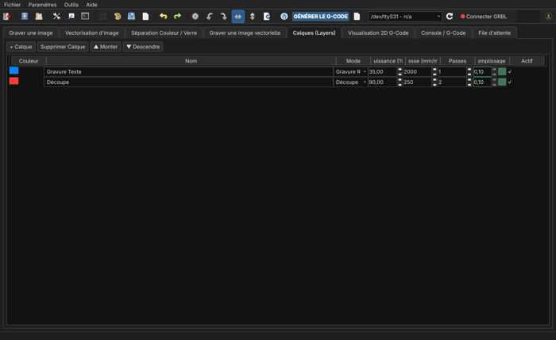

# Premiers pas

[‹ Retour au sommaire](index.md)

1. **Ouvrez une image** dans l'onglet *Graver une image*.
2. **Réglez** la taille, le contraste et le mode de tramage.
3. **Générez le G-code** puis vérifiez-le dans l'onglet *Visualisation 2D*.
4. **Connectez le graveur** et lancez le travail.

## L'onglet Calques

Pour un travail vectoriel, chaque calque a sa propre vitesse, puissance et
nombre de passes :

Le code des réglages s'écrit ainsi : `S1000 F3000`.
